# FujiNet Owner's Manual for the Emerson Arcadia 2001

*How to set up and use the FujiNet cartridge on an EMERSON ARCADIA-2001: the cartridge, joining your WiFi with the hand controller, loading games from the Internet, a memory card or your own file server, copying them, the Game Lobby, every FujiNet game for the Arcadia, and the 48-game cartridge library.*

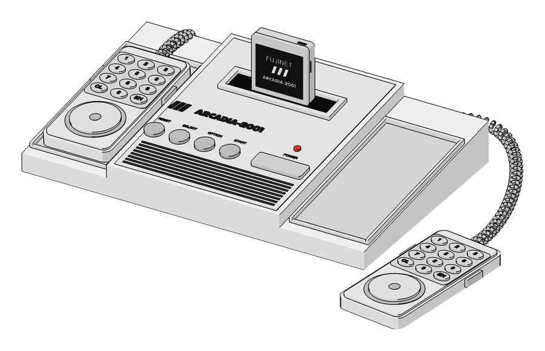

The printed edition, typeset after the 1982 Emerson *ARCADIA-2001 Owner's Manual* and its game booklets, is in the [fujinet-manuals](https://github.com/FujiNetWIFI/fujinet-manuals) repository under `arcadia/owners-manual`.

---

## Contents

1. [Unpacking Your FujiNet Cartridge](#1-unpacking-your-fujinet-cartridge)
2. [Know Your Cartridge](#2-know-your-cartridge)
3. [How It Works](#3-how-it-works)
4. [Inserting the Cartridge](#4-inserting-the-cartridge)
5. [Using the Hand Controller](#5-using-the-hand-controller)
6. [Join Your Network](#6-join-your-network)
7. [Hosts and the Browser](#7-hosts-and-the-browser)
8. [Loading Games](#8-loading-games)
9. [Copying Games](#9-copying-games)
10. [Info and the Web Control Panel](#10-info-and-the-web-control-panel)
11. [The Game Lobby](#11-the-game-lobby)
12. [5 Card Stud](#12-5-card-stud)
13. [Texas Hold'em](#13-texas-holdem)
14. [Battleship](#14-battleship)
15. [Fujitzee](#15-fujitzee)
16. [M.U.L.E.](#16-mule)
17. [The Cartridge Library](#17-the-cartridge-library)
18. [No Console? FujiNet Go](#18-no-console-fujinet-go)
19. [Maintaining Your FujiNet Cartridge](#19-maintaining-your-fujinet-cartridge)
20. [Trouble Shooting Check List](#20-trouble-shooting-check-list)
21. [Parts List](#21-parts-list)
22. [Quick Reference](#quick-reference)

### In a Hurry?

1. With the console's **POWER OFF**, push the FujiNet cartridge into the slot, label toward you. Plug a USB-C phone charger into its top.
2. Turn the television to channel 3 or 4 and the switch box to **GAME**. Press **POWER** ON.
3. **SELECT NETWORK**: move to your WiFi network with the *left* hand controller's disc and press the **Action button**.
4. Spell the password on the character grid -- disc to move, Action button to type, **ENTER** when done ([Section 6](#6-join-your-network)).
5. On **FUJINET HOSTS**, open **APPS.IRATA.ONLINE**, then **ARCADIA**, and choose a game.
6. To come back to CONFIG: **RESET** on the back of the cartridge, then the console's **RESET** ([Section 5](#5-using-the-hand-controller)).

---

## 1. Unpacking Your FujiNet Cartridge

Welcome to the wonderful world of the FujiNet cartridge for the EMERSON ARCADIA-2001. With it your 1982 micro-computer can play games kept on the Internet, on a memory card, or on a computer in your home -- and play some of them against people far away.

In the box: **the FujiNet cartridge** and **this Owner's Manual**.

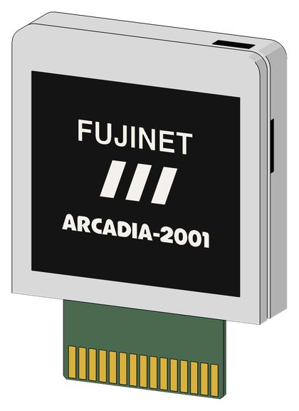

**You also need:**

- **An EMERSON ARCADIA-2001** (model ADV-1), with its two hand controllers. FujiNet is made for the **NTSC** console. The Arcadia was also sold under many other names; FujiNet has not yet been tried in those.
- **Your WiFi network's name and password.** FujiNet uses the 2.4 GHz band.

You may also want a **microSD card** (FAT32) to keep games on, and a **USB-C phone charger** for extra power -- we recommend one ([Section 4](#4-inserting-the-cartridge)).

> **NOTE:** FujiNet makes no changes to your console. Take the cartridge out and your ARCADIA-2001 is exactly as it was.

## 2. Know Your Cartridge

The **label** faces you, toward the front of the console. Everything you can press or see light up is on the **back**, the face toward your television.

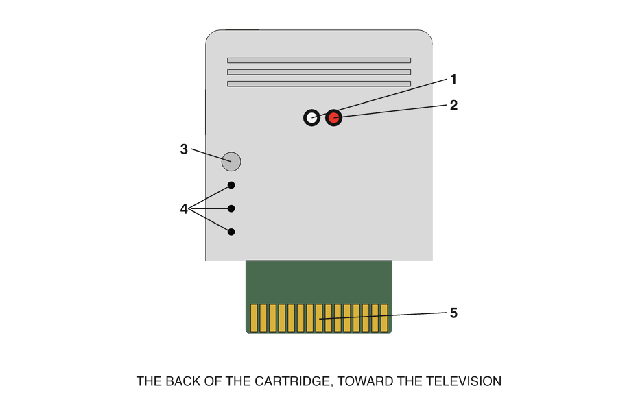

1. **Status light** -- white when FujiNet is on your WiFi; flickers orange while it is busy; dark until it has joined a network.
2. **Game light** -- red whenever the cartridge has power and its game chip is running.
3. **RESET button** -- restarts the cartridge itself; the way back to CONFIG from a game ([Section 5](#5-using-the-hand-controller)).
4. **Service holes** -- for loading new firmware. Do not push anything into them in everyday use.
5. **Contacts** -- keep them clean.

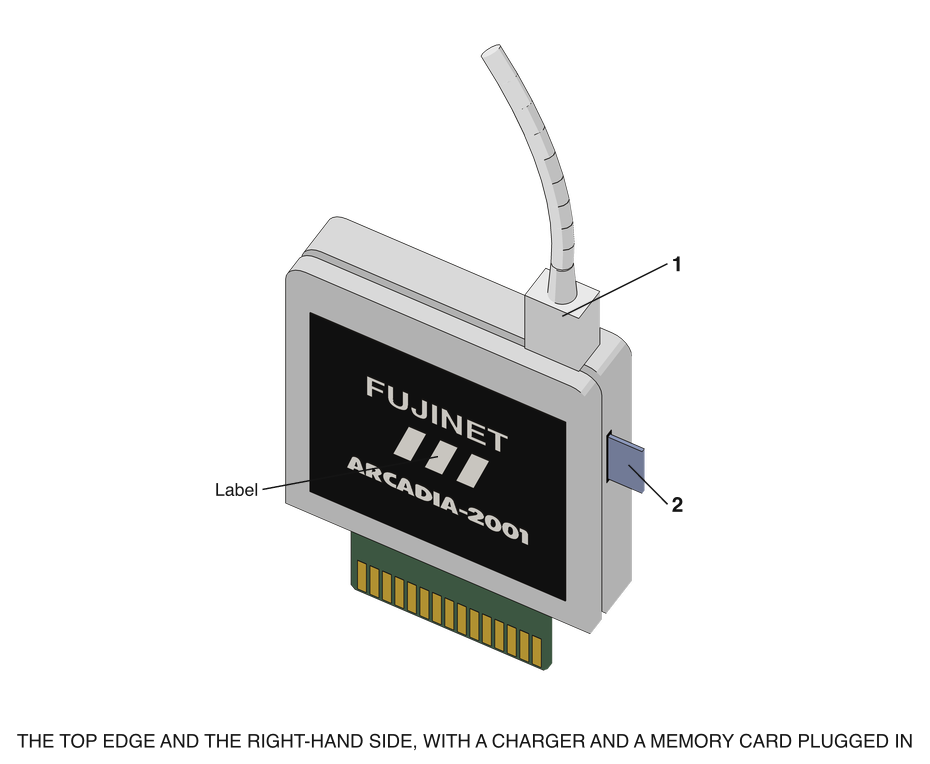

1. **USB-C socket** (top edge) -- power from a phone charger, and firmware loading. Power never flows back into the console.
2. **Memory card slot** (right-hand edge) -- push a microSD card in, contacts first, printed side toward the label, until it clicks; push again to let it out.

**A look inside** -- the board, from the back:

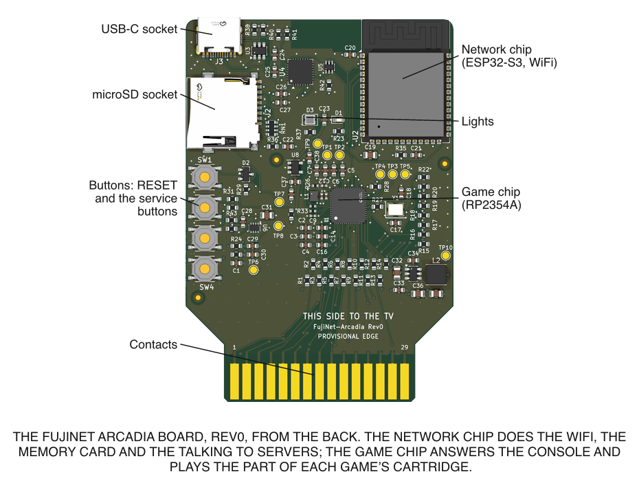

## 3. How It Works

The ARCADIA-2001's cartridge slot carries the address the console wants to read, the eight data lines that bring the answer back, and power -- no wire that says "write". The console can *read* a cartridge, but it cannot send it anything. FujiNet's game chip watches every read: reading in the *questions* pages is how the console speaks (the address it reads spells the byte it means), and the *answers* pages are where FujiNet puts what it found out.

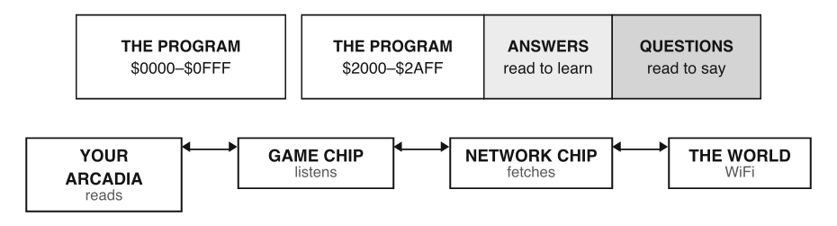

When you load a game, FujiNet sends all of it -- up to 8,192 bytes, as large as any ARCADIA-2001 cartridge -- into the game chip's memory; then the cartridge *becomes* that game's cartridge. Programs written for FujiNet may be larger: the cartridge shows M.U.L.E.'s 51,200 bytes a 2K *page* at a time (up to 71,680 bytes in all).

## 4. Inserting the Cartridge

Connect the ARCADIA-2001 to the television as its own Owner's Manual shows: the output cable into the antenna switch box, the box at **GAME**, the television on channel 3 or 4.

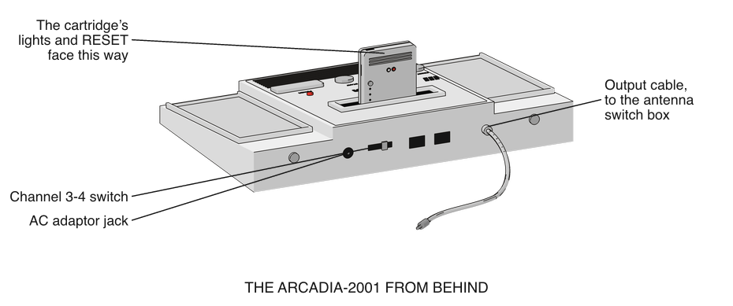

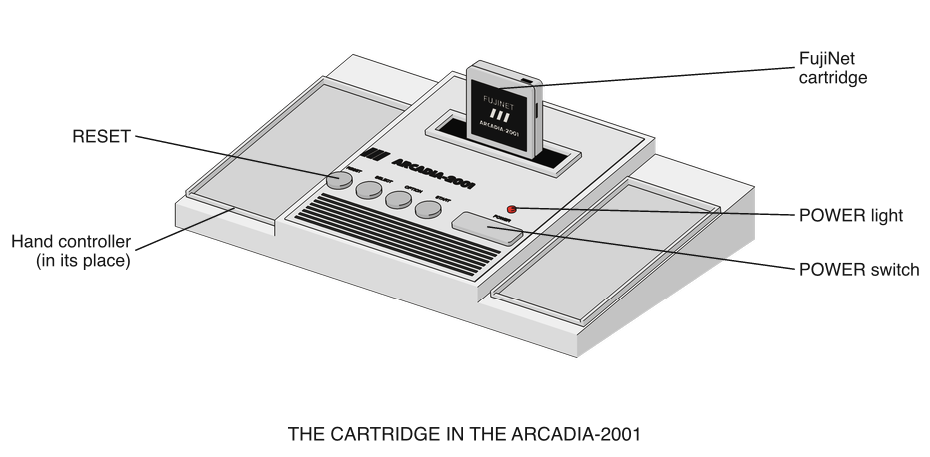

1. Be sure the **POWER** switch is OFF (red POWER light off).
2. Hold the cartridge so the label faces you, contacts down.
3. Insert it into the cartridge slot, firmly but do not force it. The top edge stays standing out of the slot.
4. Turn on the television.
5. Press **POWER** ON. The FujiNet CONFIG appears.

> **CAUTION:** Be sure the POWER light is off before the cartridge is inserted or removed. To remove it, just pull straight up.

### Extra Power

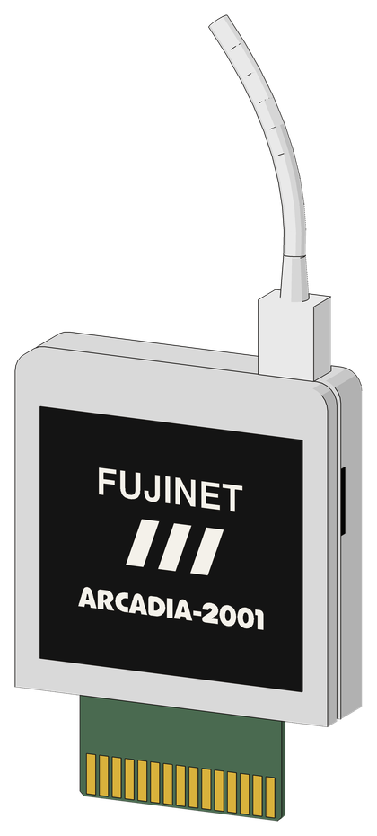

The WiFi radio needs a good deal more, in short bursts, than the games the cartridge replaces -- a quarter to two-thirds again of what the whole console draws. A **USB-C phone charger** in the top of the cartridge supplies it; the cartridge takes the charger's power first and never sends any back to the console. **Plug it in before you turn the console on.** With a charger in, FujiNet stays awake while the console is off, with the game it last loaded still in it.

## 5. Using the Hand Controller

CONFIG listens to the **left** hand controller.

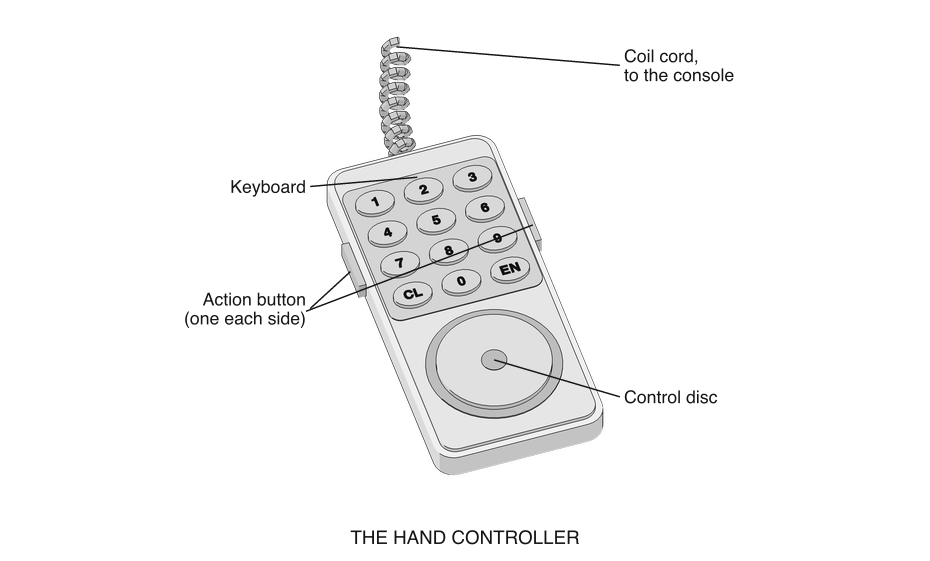

> **IMPORTANT:** On the ARCADIA-2001 the Action buttons and the **2** button are one and the same. In CONFIG and every FujiNet game, **2** does what the Action button does.

| Everywhere in CONFIG | |
|---|---|
| Disc up/down, or **8** | Move along the list (8 goes down, and round to the top). Hold to repeat. |
| **Action**, **2** or **ENTER** | Choose the line the bar is on. |
| **CLEAR** | Go back. |

The other buttons do what each screen's bottom lines say. CONFIG does not use START, SELECT or OPTION.

**Keyboard overlay** -- CONFIG's, to copy onto a blank overlay:

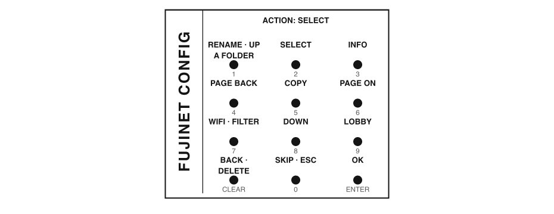

### Getting Back to CONFIG

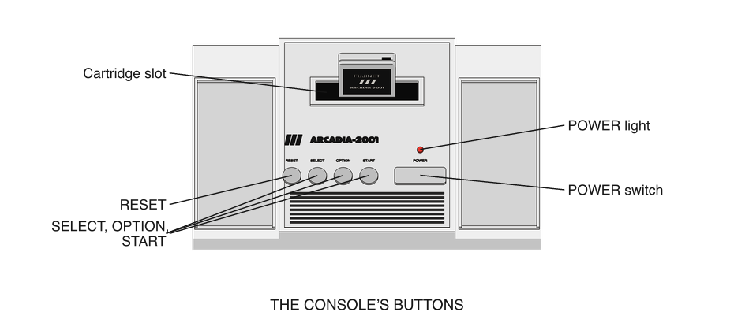

The console's **RESET** restarts the game you are playing, not CONFIG. To leave a game:

1. Press **RESET** on the back of the FujiNet cartridge.
2. Press the console's **RESET**.

Turning the console's POWER OFF and ON does the same when the cartridge runs on the console's power. With a USB-C charger in, use the cartridge's RESET.

## 6. Join Your Network

CONFIG first says **WAITING FOR LINK** while the network chip wakes (a few seconds; any button hurries it). If FujiNet knows your network it joins it and goes to the hosts. The first time it shows **SELECT NETWORK**:

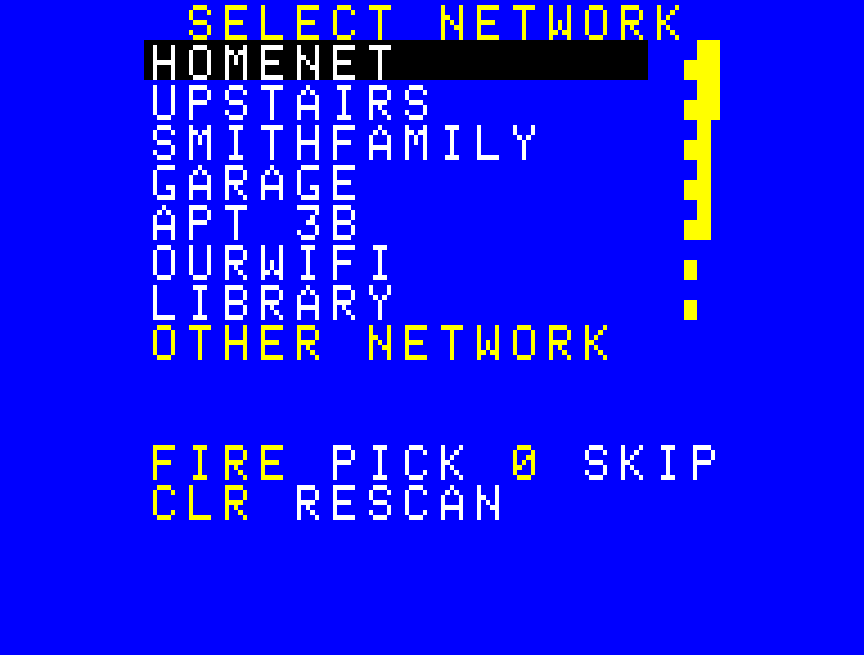

Up to seven networks, strongest first, with a block for signal strength; **OTHER NETWORK** for a hidden one. **CLEAR** listens again; **0** skips WiFi (games from the memory card still play).

1. Move the bar to your network and press the Action button.
2. Spell the password on the character grid (below) and press **ENTER**: **SAVING**, then **CONNECTING**.

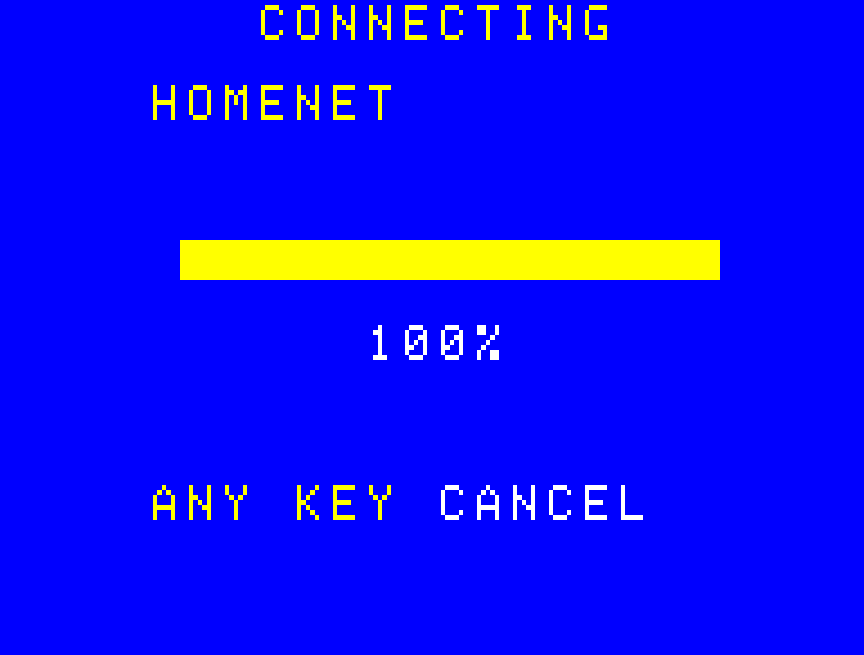

When it has joined, three notes sound, the status light turns white and the hosts appear. **CONNECT FAILED** goes back to SELECT NETWORK.

### The Character Grid

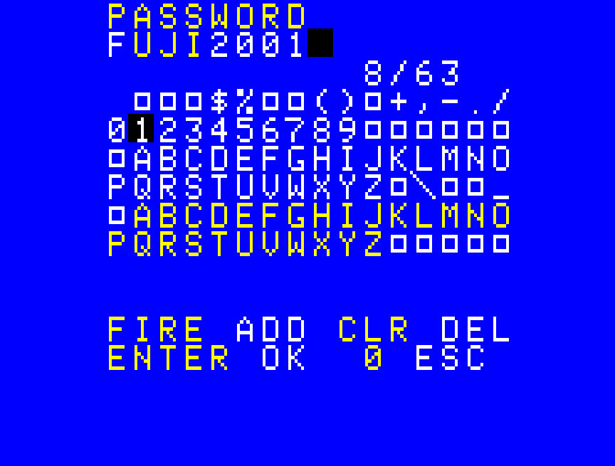

| On the grid | |
|---|---|
| Disc, or **4 6 8** | Move the cursor (it goes round at the edges). |
| **Action** or **2** | Type the character under the cursor. |
| **CLEAR** | Erase the last character. |
| **ENTER** | Accept. |
| **0** | Leave without changing anything. |

The ARCADIA-2001 has no small letters and few symbols: small letters show as **yellow** capitals, and a symbol it cannot draw shows as a box -- move the cursor onto it to see which. Passwords care about capitals, so watch the colour. Limits: password 63, network name 32, host 31, filter 15.

## 7. Hosts and the Browser

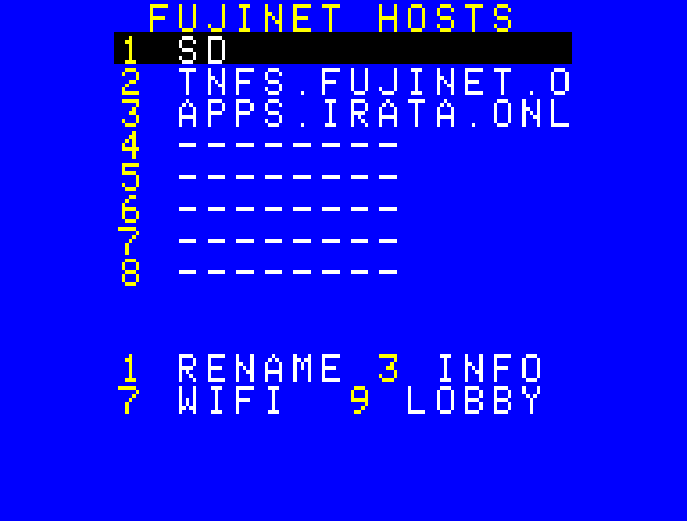

FujiNet remembers eight **hosts**. A new one has **SD** (the memory card), **TNFS.FUJINET.ONLINE** and **APPS.IRATA.ONLINE**; the rest show dashes.

| On FujiNet hosts | |
|---|---|
| **Action** / **ENTER** | Open the host. |
| **1** | Rename: fill in or change a host. |
| **3** | INFO ([Section 10](#10-info-and-the-web-control-panel)). |
| **7** | Choose a WiFi network again. |
| **9** | The Game Lobby ([Section 11](#11-the-game-lobby)). |

A plain name means a TNFS server; FujiNet also reaches `smb://server/share`, `nfs://server/export`, `ftp://server` and `http(s)://server/path`.

**The browser** shows eight names a page; folders are yellow and end in `/`; the blocks at the right show how far down you are.

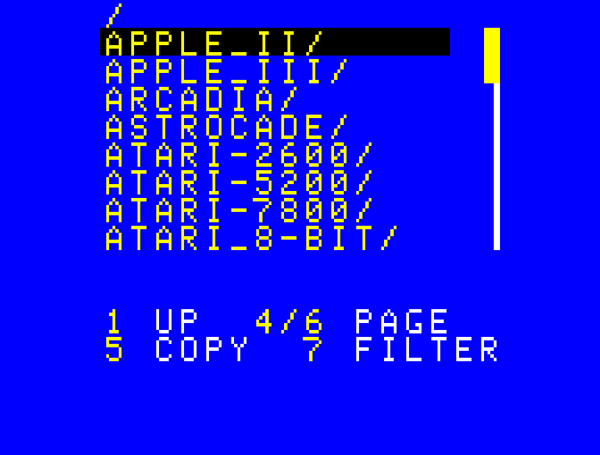 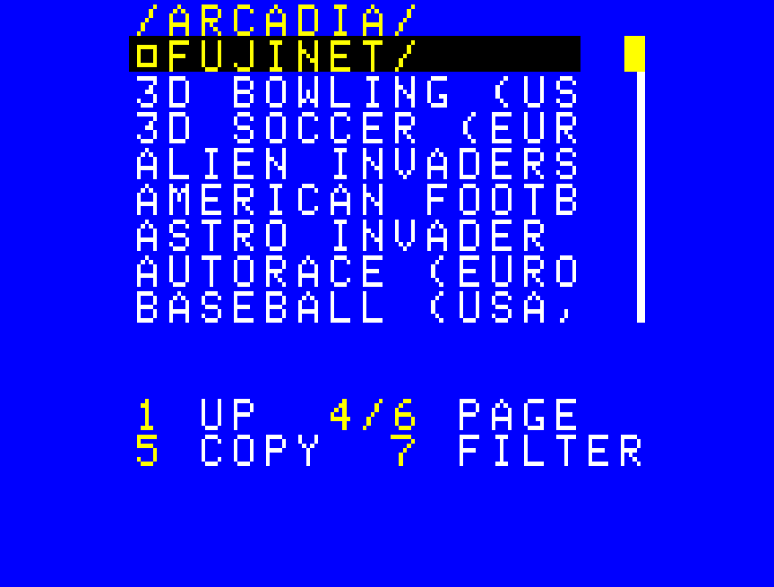

| In the browser | |
|---|---|
| Disc up/down, or **8** | Move; past the bottom, the next page. |
| Disc left/right, or **4 6** | Turn the page. |
| **Action** / **ENTER** | Open a folder, or load a game. |
| **1** | Up a folder. |
| **5** | Copy ([Section 9](#9-copying-games)). |
| **7** | Filter. |
| **CLEAR** | Back to the hosts. |

Names are cut to 14 characters. **Filters** match the whole name: `*` any letters, `?` one letter, so `*JU*` finds Jungler and Jump Bug.

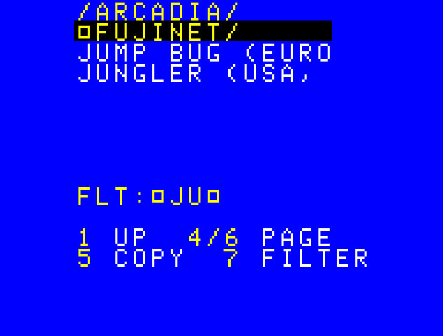

## 8. Loading Games

Find the game and press the Action button. **BOOTING** fills its bar, a short fanfare plays, and the game starts as if its own cartridge were in the slot.

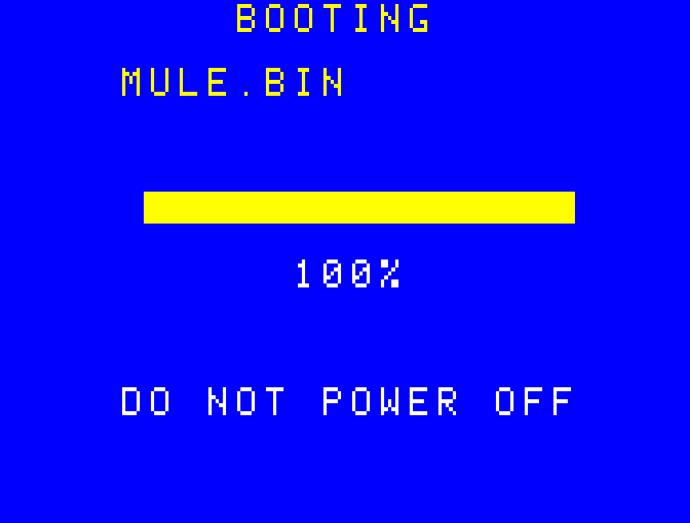

| Host | Folder | What is there |
|---|---|---|
| **APPS.IRATA.ONLINE** | **ARCADIA** | all 48 ARCADIA-2001 games ([Section 17](#17-the-cartridge-library)) |
| **APPS.IRATA.ONLINE** | **ARCADIA / !FUJINET** | 5 Card Stud, Battleship, Fujitzee, Texas Hold'em |
| **APPS.IRATA.ONLINE** | **MULE / ARCADIA** | M.U.L.E. |
| **TNFS.FUJINET.ONLINE** | | the FujiNet project's library |

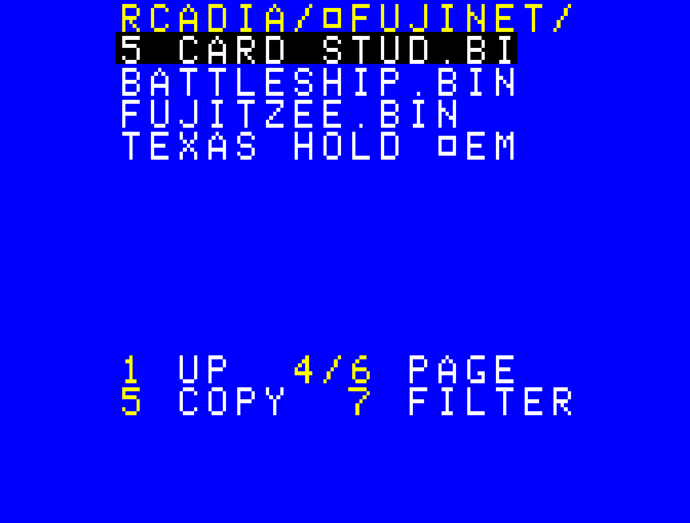

**From the memory card:** copy games onto a FAT32 microSD card, put it in the cartridge with the console off, and open **SD**. **From your own server:** run a TNFS server (see fujinet.online) and rename an empty host to its address.

**Which games load:** every ARCADIA-2001 game up to 8,192 bytes, and FujiNet programs up to 71,680; files ending **.BIN** or **.ROM** (rename `.ARC` to `.BIN`). 47 of the library's 48 play; **Golf**'s cartridge was wired unlike any other, and FujiNet does not imitate it yet.

| Screen says | What it means |
|---|---|
| **NOT A CART** | Not a game, or the name does not end in .BIN or .ROM. |
| **ROM TOO BIG** | Larger than 71,680 bytes. |
| **STAGE ERROR** | Larger than 8,192 bytes but not made for FujiNet. |
| **TRUNCATED** | Cut short on its way; try again. |
| **PATH ERROR**, **MOUNT ERROR** | The host or file could not be opened. |

To leave a game: the cartridge's RESET, then the console's RESET.

## 9. Copying Games

1. In the browser, move to the game and press **5**.
2. **COPY TO HOST**: choose the host to copy to (**SD** for the card) and press the Action button.
3. Open the folder it should go in.
4. Press **5** to copy it there.

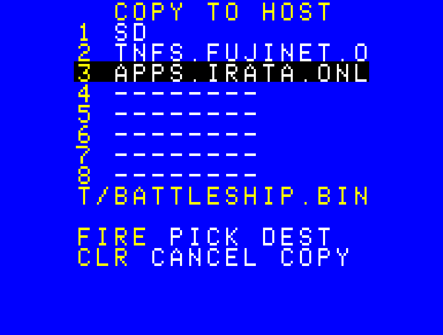 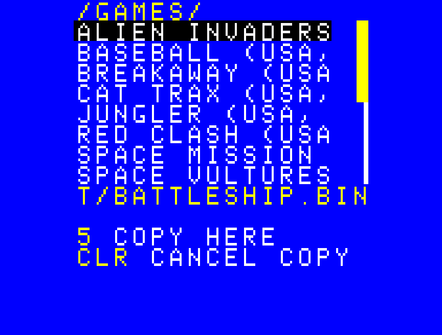

**COPYING**, then **COPIED**; **CLEAR** cancels. **COPY FAILED**: the card may be full, or the host read-only. Folders cannot be copied (**FILES ONLY**). A game's `.CFG` settings file goes with it.

## 10. Info and the Web Control Panel

Press **3** on the hosts:

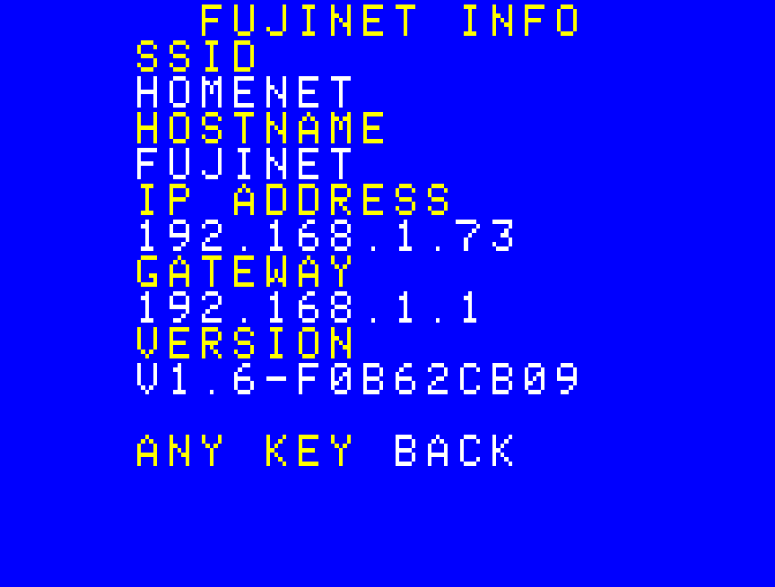

SSID, HOSTNAME, IP ADDRESS, GATEWAY and VERSION. Type the IP address into a web browser (or try `http://fujinet.local/`) for the control panel: WiFi, hosts, the memory card, the version, with a real keyboard. Or put a `fnconfig.ini` on the card:

```
[WiFi]
enabled=1
SSID=YourNetworkName
passphrase=YourPassword
```

## 11. The Game Lobby

Press **9** on the hosts. CONFIG looks for **ec.tnfs.io** among your hosts (putting it in host 8 if it is not there) and loads the Lobby from it.

> **NOTE:** The ARCADIA-2001's Lobby is being finished now, and is not yet on ec.tnfs.io. Until it is, load the network games from the browser ([Section 8](#8-loading-games)).

The first time, it asks **YOUR NAME** (2 to 8 letters and numbers) and remembers it. Then the open tables, six to a page, under each game:

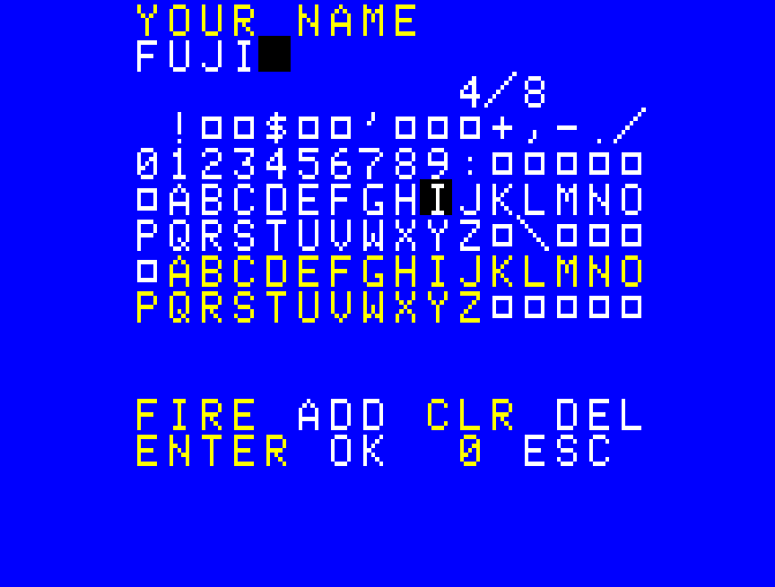 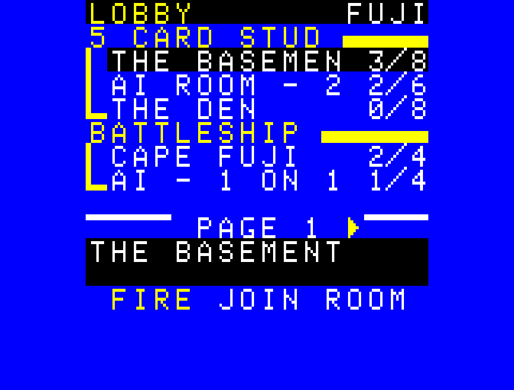

Disc up/down or **8**: move; left/right or **4 6**: page; **Action**/**ENTER**: join; **0**: fetch again; **CLEAR**: change your name. The **AI Rooms** seat you with robots.

## 12. 5 Card Stud

*Host APPS.IRATA.ONLINE, file ARCADIA/!FUJINET/5 Card Stud.bin.* Up to eight players; robots fill empty seats. One card down and four up, the best poker hand takes the pot; everyone starts with **200**.

1. **YOUR NAME** (with ARCADIA spelled): disc up/down spins the letter, **4**/**6** move the cursor, **ENTER** accepts.
2. **CHOOSE A TABLE**: *The Basement* and *The Den* for people, the *AI Rooms* with 2, 4 or 6 robots. Disc to move, **ENTER** joins, **CLEAR** renames, **0** fetches again.

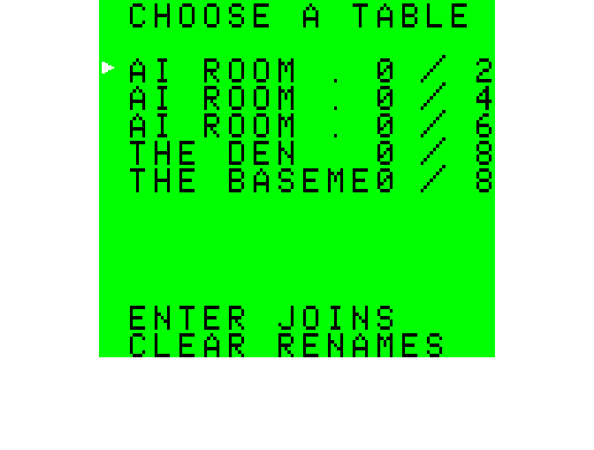 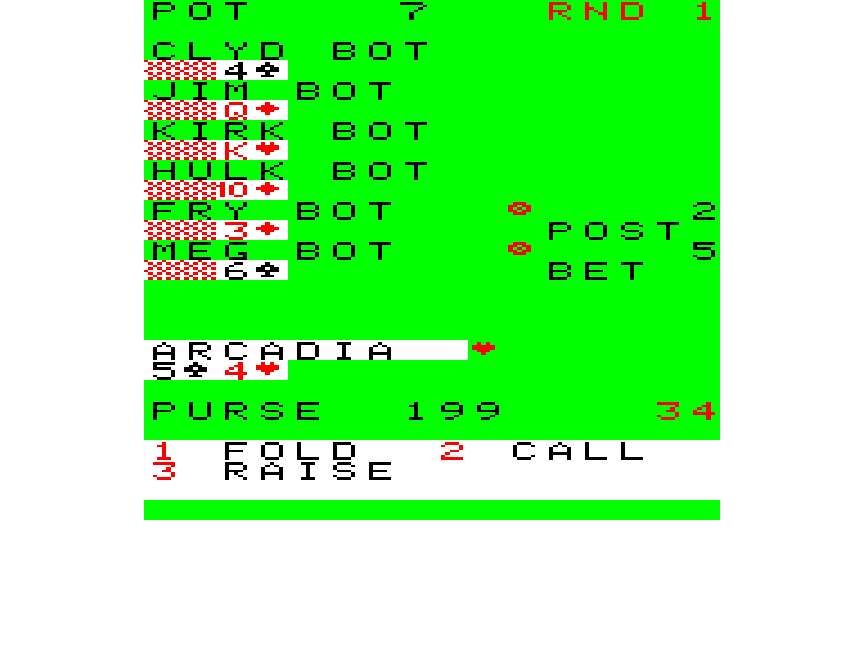

**Rules:** ante 1; the lowest card showing must **POST**; then **CALL**, **BET**/**RAISE**, **CHECK** or **FOLD**; third, fourth and fifth cards each with a betting round (5, then 10; three raises at most); the best hand wins.

**Play:** your moves are numbered on the white line -- press **1** to **5** (the Action button is move 2). About forty seconds a move; then the server moves for you. **0** asks the server now; **CLEAR** leaves the table properly.

## 13. Texas Hold'em

*File ARCADIA/!FUJINET/Texas Hold 'em.bin.* Two cards of your own, five shared; 1,000 chips; blinds 5 and 10; the flop, the turn and the river, each with a betting round. Name, tables and buttons as 5 Card Stud.

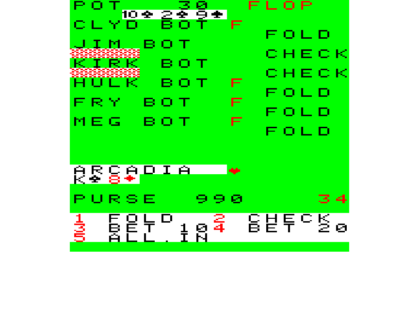

The shared cards are under the pot, the round (PRE, FLOP, TURN, RIVER, SHOW) at the right, your moves on the white line.

## 14. Battleship

*File ARCADIA/!FUJINET/Battleship.bin.* Two to four fleets of five ships (5, 4, 3, 3, 2); every shot lands on **every** enemy board at once; the last fleet afloat wins. The *AI* tables give 1-3 robot admirals; *Cape Fuji* and *High Seas* are for people. In the **LOBBY**, press the Action button when ready.

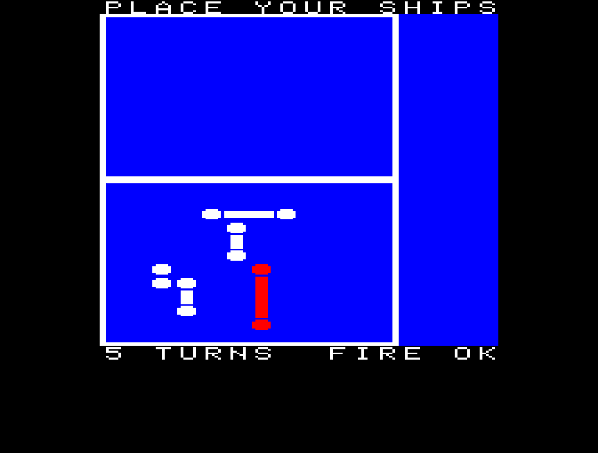 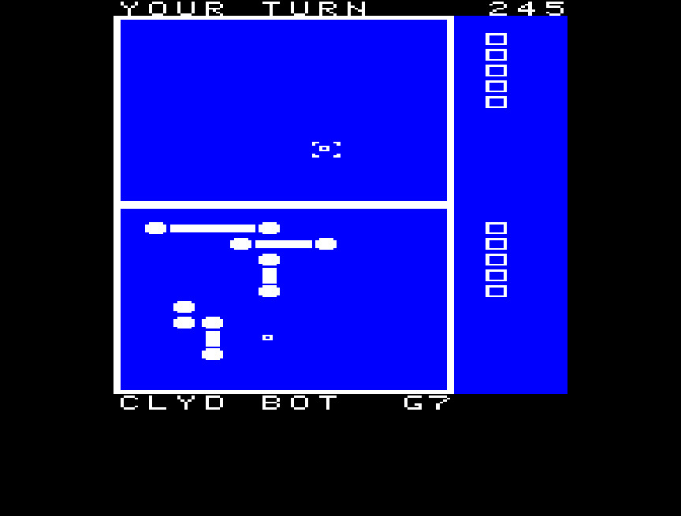

| | |
|---|---|
| Disc | Aim; while placing, move the ship. |
| **Action** / **ENTER** | Fire; place a ship. |
| **5** | Turn a ship. |
| **4 6** | Show another enemy's board. |
| **0** | Ask the server now. |
| **CLEAR** | Leave. |

## 15. Fujitzee

*File ARCADIA/!FUJINET/Fujitzee.bin.* Roll five dice up to three times a turn, keep the ones you like, score a box. *The Bar* and *Kitchen Table* for people, *AI Rooms* with robots; **FIRE TO READY** in the lobby.

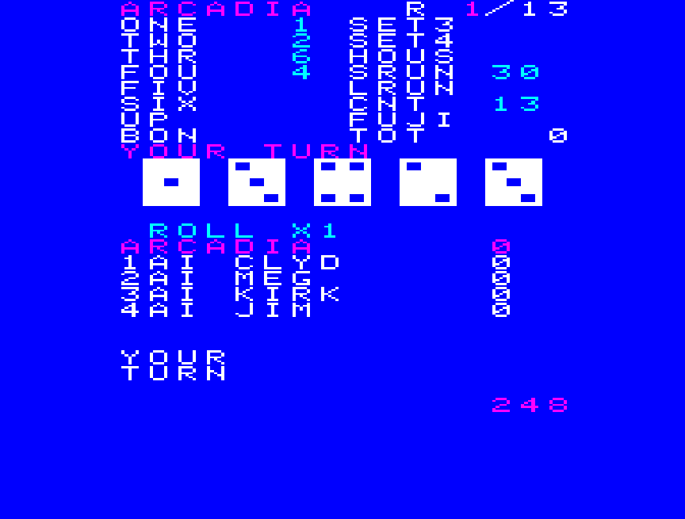

1. The pointer starts on **ROLL**: press the Action button.
2. Left/right along the dice; the Action button keeps a die (again to let it go).
3. Down to ROLL and roll again -- three rolls in all.
4. Up onto the card, choose a box and press the Action button.

ONE-SIX the dice of that number; UP/BON the top total and a 35 bonus at 63; SET3/SET4 all five dice; HOUS 25; SRUN 30; LRUN 40; CNT all five; FUJI 50. **0** asks the server now; **CLEAR** leaves.

## 16. M.U.L.E.

*Host APPS.IRATA.ONLINE, file MULE/ARCADIA/mule.bin.* Settle the planet Irata with three colonists on any FujiNet machine -- at 51,200 bytes, the largest program the cartridge plays.

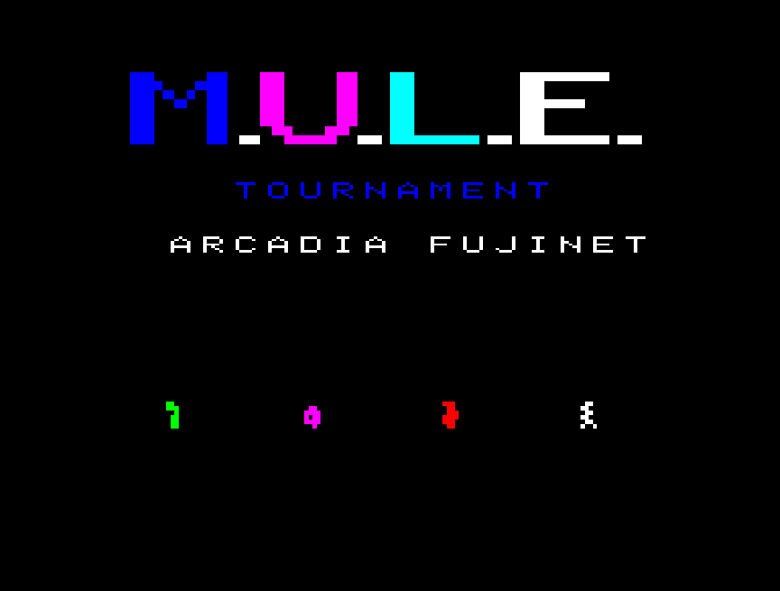 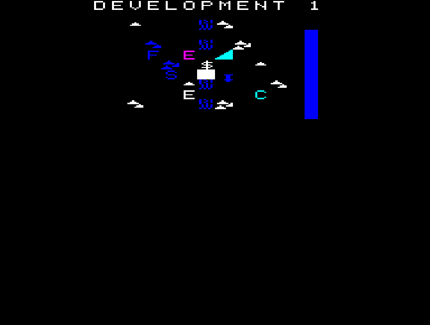

Name: disc up/down picks a letter, right takes it, left rubs out; **ENTER** or the console's **START** when done. Choose a table (**DISC, THEN FIRE**), then your species, and press the Action button when ready.

| | |
|---|---|
| Disc | Walk; choose; move your auction line; up to sell, down to buy. |
| **Action** / **2** | Every "press the button" of the game. |
| **START** | End your turn. |
| **OPTION** | Leave the table (asks first). |
| **SELECT** | Sound off and on. |
| **0** | Sit out a declaration. |

If it says it **NEEDS A FUJINET CART, PROTO 2.**, update the cartridge's firmware. The whole game is in the *M.U.L.E. Player's Guide*.

## 17. The Cartridge Library

All 48 ARCADIA-2001 cartridges, in **APPS.IRATA.ONLINE / ARCADIA**: 3D Bowling, 3D Soccer\*, Alien Invaders, American Football, Astro Invader\*, Autorace\*, Baseball, Basketball\*, Blackjack and Poker\*, Boxing\*, Brain Quiz, Breakaway, Capture, Cat Trax, Circus\*, Combat\*, Crazy Climber\*, Crazy Gobbler\*, Escape, Funky Fish\*, Golf\*†, Grand Slam Tennis, Hobo\*, Horse Racing\*, Jump Bug\*, Jungler, Missile War, Monaco Grand Prix\*, Nibblemen\*, Ocean Battle, Parashooter\*, Pleiades\*, R2D Tank\*, Red Clash, Robot Killer\*, Route 16\*, Soccer, Space Attack, Space Mission, Space Raiders, Space Squadron\*, Space Vultures, Spiders, Star Chess, Super Gobbler\*, Tanks a Lot, The End\*, Turtles\*.

\* Sold in Europe, for look-alike consoles; they play on the ARCADIA-2001 too. † Golf does not play from FujiNet yet.

Each game's own booklet tells which overlay goes where; most use SELECT for the game number, OPTION for the skill and START to start.

## 18. No Console? FujiNet Go

**FujiNet Go Arcadia 2001 Desktop** -- an ARCADIA-2001 for Windows, Mac or Linux with a FujiNet cartridge already in its slot, free from [its releases page](https://github.com/FujiNetWIFI/fujinet-go-arcadia-desktop/releases). Keys: **1-9, 0**; **Backspace** = CLEAR; **Enter** = ENTER; arrows = disc; **Right Ctrl** = Action; **F2/F3/F4** = START/OPTION/SELECT; **F1** = RESET; **Escape** = back to CONFIG; **F9** the Controllers window. *File ▸ Open cartridge* plays a game of your own (Golf's too); *External FujiNet* in Preferences points it at a FujiNet elsewhere on your network.

## 19. Maintaining Your FujiNet Cartridge

- Turn the POWER OFF before putting the cartridge in or taking it out; do not force it.
- Do not push anything into the three service holes.
- Push the memory card straight in and let it spring straight out.
- Use only a USB-C phone charger or a computer's USB port.
- Keep the cartridge away from heat and moisture; clean it with a slightly damp cloth only.

New firmware, and how to load it, is announced at **fujinet.online**. It does not change your hosts or WiFi.

## 20. Trouble Shooting Check List

| Symptom | Cause And Remedy |
|---|---|
| No picture, or a grey screen | Switch box at TV (set GAME); TV not on channel 3/4; cartridge not seated, or put in with the POWER on: turn OFF, reseat, turn ON. |
| **NO FUJINET CART** | Reseat the cartridge with the POWER off; else the cartridge's RESET, then the console's. |
| The picture jumps when WiFi connects | Not enough power: plug a USB-C charger into the cartridge before turning on. |
| The controller does nothing | CONFIG listens to the left hand controller. |
| My network is not listed | Too far away; 5 GHz only; hidden (choose OTHER NETWORK); press CLEAR to listen again. |
| **CONNECT FAILED** | Wrong password (small letters show yellow); or set WiFi from the web panel or `fnconfig.ini`. |
| A host shows nothing, **HOST ERROR**, **FOLDER ERROR** | Misspelled host; server down; no or unformatted memory card. |
| **NOT A CART** | Not .BIN or .ROM (rename .ARC to .BIN), or not an Arcadia game. |
| **ROM TOO BIG**, **STAGE ERROR**, **TRUNCATED** | See [Section 8](#8-loading-games). |
| I cannot get back to CONFIG | The cartridge's RESET, then the console's RESET. |
| Golf stops at its first screen | FujiNet cannot play Golf yet. |

**Getting help:** [fujinet.online](https://fujinet.online), [github.com/FujiNetWIFI](https://github.com/FujiNetWIFI), [the FujiNet Discord](https://discord.gg/7MfFTvD).

## 21. Parts List

| | |
|---|---|
| Board | FujiNet-Arcadia Rev0 (`fujinet-hardware`, Emerson-Arcadia) |
| Game chip | RP2354A (RP2350 with 2 MB flash) |
| Network chip | ESP32-S3-WROOM-1, 16 MB flash, 8 MB PSRAM |
| WiFi | 802.11 b/g/n, 2.4 GHz |
| Memory card | microSD, push-push, FAT32 |
| USB | USB-C: power, and firmware loading |
| Lights | status (white / orange); game chip (red) |
| Buttons | RESET; three service buttons (BOOTSEL, S3 RST, S3 BOOT) |
| Power | the cartridge slot, or USB-C (USB-C first) |
| Console | EMERSON ARCADIA-2001 (ADV-1), NTSC |
| Games | up to 8,192 bytes; FujiNet programs up to 71,680; .BIN or .ROM |

## Quick Reference

| Screen | Disc | Action, 2, ENTER | Keyboard | CLEAR |
|---|---|---|---|---|
| Select network | choose | this one | 0 skip WiFi | listen again |
| Character grid | move (or 4 6 8) | type · ENTER: OK | 0 leave | erase |
| FujiNet hosts | choose (or 8) | open | 1 rename · 3 info · 7 WiFi · 9 Lobby | -- |
| Browser | choose; left/right: page | open · load | 1 up · 4 6 page · 5 copy · 7 filter | to hosts |
| Copy to host | choose | pick · open | 5 copy here | cancel |
| Game Lobby | choose; left/right: page | join | 0 list again | your name |
| 5 Card Stud, Hold'em | choose a table | join · move 2 | 1-5 your move · 0 ask now | leave |
| Battleship | aim; move a ship | fire · place · ready | 5 turn · 4 6 enemy · 0 ask now | leave |
| Fujitzee | boxes; dice; ROLL | roll · keep · score | 0 ask now | leave |
| M.U.L.E. | walk · choose · bid | the button | 0 sit out · START end turn · OPTION leave · SELECT sound | rub out |
| **Back to CONFIG** | the cartridge's RESET, then the console's RESET | | | |

---

*FujiNet is an independent project and is not affiliated with Emerson. "Emerson" and "Arcadia 2001" are trademarks of their owners; "M.U.L.E." is a trademark of its owner. Text and pictures © 2026 the FujiNet Project, CC BY-SA 4.0.*
