# FujiNet Owner's Manual for the Atari 5200

*How to set up and use the FujiNet cartridge on an ATARI 5200: the cartridge, joining your WiFi with the controller, loading games from the Internet, a memory card or your own file server, copying them, the Game Lobby, and the six FujiNet network games.*

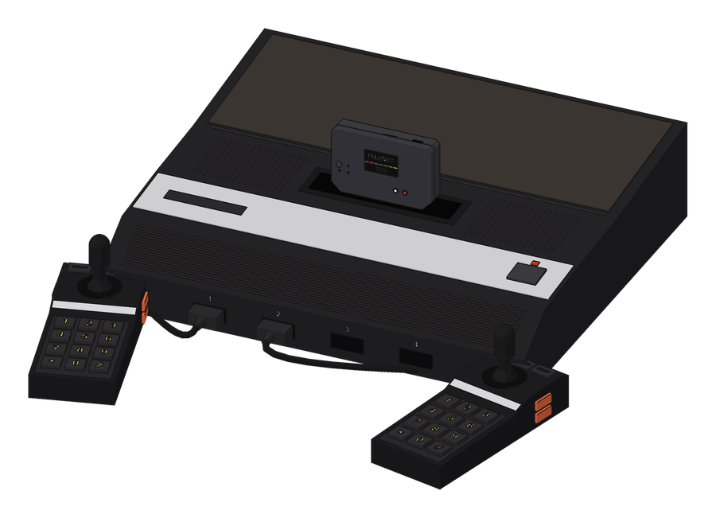

The printed edition, typeset after the 1982 *ATARI 5200 Owner's Manual*, is in the [fujinet-manuals](https://github.com/FujiNetWIFI/fujinet-manuals) repository under `atari-5200/owners-manual`. Programmers want the [FujiNet Programming Guide for the Atari 5200](FujiNet-Programming-Guide-for-the-Atari-5200).

---

## Contents

1. [Unpacking Your FujiNet Cartridge](#1-unpacking-your-fujinet-cartridge)
2. [Know Your Cartridge](#2-know-your-cartridge)
3. [How It Works](#3-how-it-works)
4. [Inserting the Cartridge](#4-inserting-the-cartridge)
5. [Using the 5200 Controller](#5-using-the-5200-controller)
6. [Join Your Network](#6-join-your-network)
7. [Hosts and the Browser](#7-hosts-and-the-browser)
8. [Loading Games](#8-loading-games)
9. [Copying Games](#9-copying-games)
10. [Info and the Web Control Panel](#10-info-and-the-web-control-panel)
11. [The Game Lobby](#11-the-game-lobby)
12. [5 Card Stud](#12-5-card-stud)
13. [Texas Hold'em](#13-texas-holdem)
14. [Battleship](#14-battleship)
15. [Fujitzee](#15-fujitzee)
16. [Fujirkle](#16-fujirkle)
17. [M.U.L.E.](#17-mule)
18. [Maintaining Your FujiNet Cartridge](#18-maintaining-your-fujinet-cartridge)
19. [Troubleshooting Checklist](#19-troubleshooting-checklist)
20. [Parts List](#20-parts-list)
21. [Quick Reference](#quick-reference)

### In a Hurry?

1. With the console's **POWER OFF**, push the FujiNet cartridge into the slot, label toward you. Plug a controller into **jack 1**. On a four-port console, plug a USB-C phone charger into the top of the cartridge too.
2. Press **POWER ON**. The FujiNet menu appears.
3. Pick your WiFi network with the joystick and press the **bottom button**. Spell the password on the on-screen keyboard and press **START** ([Section 6](#6-join-your-network)).
4. On **HOST SLOTS**, move to **apps.irata.online** and press the bottom button. Open **ATARI-5200**, then **FUJINET**.
5. Move to a game and press the bottom button. It loads and starts by itself.
6. To come back to the FujiNet menu, turn the console **OFF and ON** again.

---

## 1. Unpacking Your FujiNet Cartridge

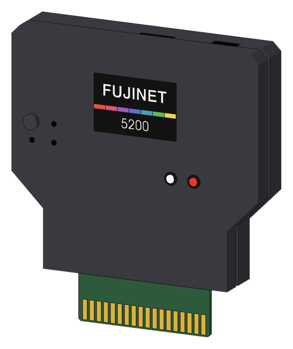

When you take the FujiNet cartridge from its box, you will have the FujiNet cartridge and this Owner's Manual.

The FujiNet cartridge goes in your console's cartridge slot like any other game. Inside it is a complete network adapter: a WiFi radio, a memory-card reader and two small computers. It lets your 5200 play games that are kept on the Internet, on a memory card, or on a computer in your home — and play some of them against people far away.

### What You Also Need

- **An ATARI 5200** of any model: the original four-port console, the later four-port, or the two-port model. FujiNet is made for **NTSC** (North American) consoles and television sets.
- **A 5200 controller**, plugged into **jack 1**.
- **Your WiFi network's name and password.** FujiNet uses the 2.4 GHz band.

You may also want a **microSD memory card** (formatted FAT32) to keep games on, and a **USB-C phone charger** for extra power — with a four-port console you will most likely need one ([Section 4](#4-inserting-the-cartridge)).

> **NOTE:** FujiNet makes no changes to your console. Take the cartridge out and your 5200 is exactly as it was.

## 2. Know Your Cartridge

The **label** faces you, toward the front of the console, and carries everything you can press or see light up. The top edge, which stands up out of the console, has the sockets for power and the memory card.

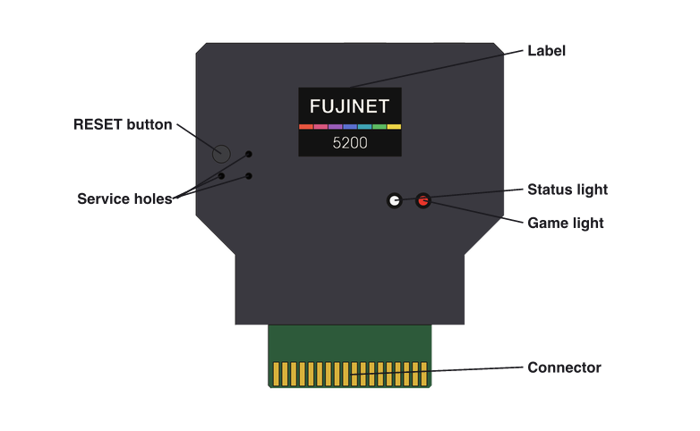

| Light | What it means |
|---|---|
| **Status**, white | FujiNet is connected to your WiFi network. |
| **Status**, orange, flickering | FujiNet is busy: reading the network or the memory card, or sending a game to the console. |
| **Status**, off | FujiNet is not connected to WiFi (yet). |
| **Game**, red | A game has been sent to the console since you turned it on. Dark while the FujiNet menu is on the screen. |

**The RESET button** restarts the cartridge itself: both of its small computers. The 5200 cannot be told, so after pressing it, turn the console OFF and ON again. You will rarely need it; turning the console OFF and ON is the everyday way back to the FujiNet menu.

> **IMPORTANT:** The three small **service holes** beside RESET are for loading new firmware. Do not push anything into them in everyday use.

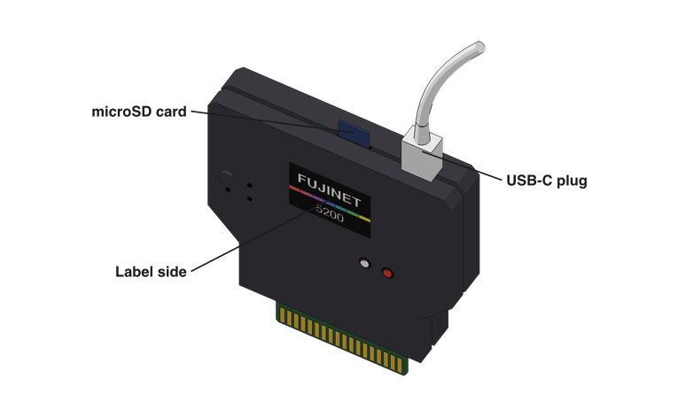

**USB-C socket.** The cartridge can run on power from the console, and a USB-C phone charger plugged in here powers it too. Power from the charger never flows back into the console. The same socket loads new firmware.

**Memory card slot.** A microSD card pushes into the slot beside the USB-C socket, contacts first and its printed side toward the label, until it clicks; push again to let it out.

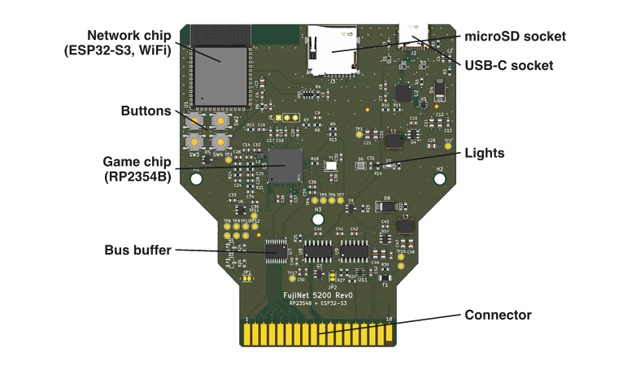

*The FujiNet 5200 board, Rev0, seen from the label side. The network chip does the WiFi, the memory card and the talking to servers; the game chip answers the console and plays the part of each game's cartridge.*

## 3. How It Works

Your 5200 was built in 1982 to play cartridges. It has no network port, no keyboard and no disk drive, and its connector for a cartridge has no wire that says "write": the console can *read* a cartridge, but has no way to send it anything at all. A FujiNet cartridge puts it on the Internet anyway.

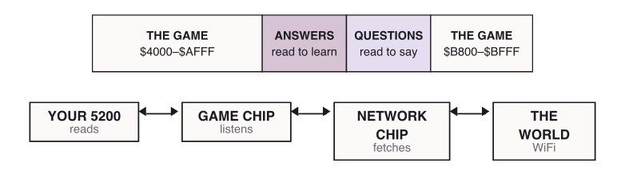

The console sees a cartridge as 32,768 bytes it can look at. FujiNet's game chip watches *every* look: which address the console reads, at the moment it reads it. So FujiNet sets aside a few pages of that space. Reading in the **questions** pages is how the console speaks — the address it reads spells the byte it means. The **answers** pages are where FujiNet puts what it found out, and the console reads them like any other part of a cartridge.

1. **Ask.** The program reads its question out of the questions pages, one byte at a time: to say 65, it reads the 65th place in the page.
2. **Pass it on.** The game chip hands the question to the network chip beside it.
3. **Fetch.** The network chip joins your WiFi, reaches the server, or reads the memory card.
4. **Answer.** The answer goes into the answers pages, and the console simply reads it.

| | The console, 1982 | The cartridge, 2026 |
|---|---|---|
| Computers | one 6502C, about 1.8 million steps a second | two, each over a hundred times faster |
| Memory | 16,384 bytes | over half a million bytes, and 8 million more beside |
| Storage | the 32K a cartridge shows it | 18 million bytes of its own, and the memory card |
| Network | none | WiFi, and through it the whole Internet |

**Whole games.** When you load a game, FujiNet sends all of it — up to 131,072 bytes — into the game chip's memory. Then the cartridge becomes that game's cartridge: a plain one, a two-chip one, Bounty Bob Strikes Back's, or a 128K Super Cart. The console starts the game as it would at power-on.

## 4. Inserting the Cartridge

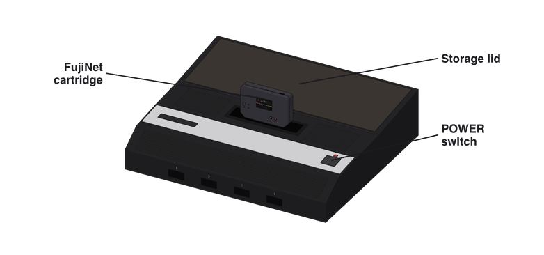

1. Check that the console's **POWER** is **OFF**.
2. Hold the FujiNet cartridge so the label faces you and reads right side up.
3. Carefully insert it into the cartridge slot. Be sure it fits firmly, but DO NOT FORCE IT IN. The top edge, with its USB-C socket, stays standing out of the slot.
4. Plug your controller into **jack 1**.
5. Turn your television on.
6. Press the console's **POWER ON/OFF** switch. The red light beside it glows, and the FujiNet menu appears.

> **IMPORTANT:** The console's POWER should be OFF whenever you put a cartridge in or take one out.

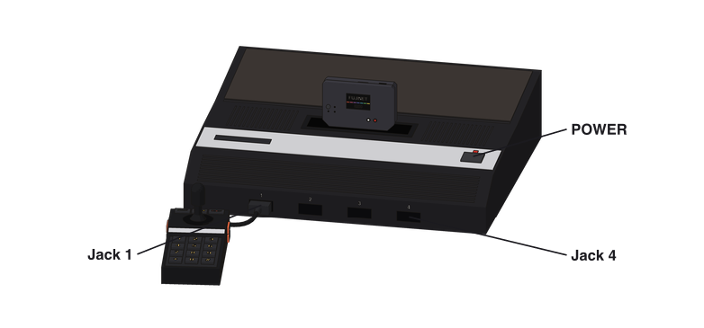

The FujiNet menu and every FujiNet game listen to the controller in **jack 1**.

### Extra Power

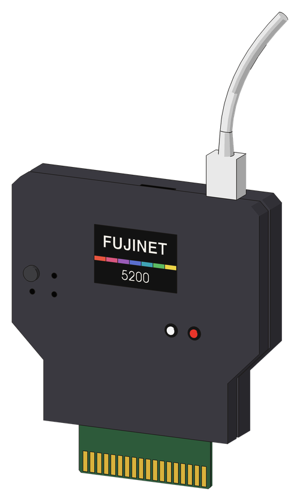

The cartridge can run on power from the console, but its WiFi radio needs more, in short bursts, than some consoles have to spare. A **USB-C phone charger** plugged into the top of the cartridge supplies it, and never sends any of it back to the console.

- **Four-port consoles.** Use a charger. The original four-port console feeds the cartridge from the same small supply that runs its own memory and controllers, and WiFi can overload it.
- **Two-port consoles** power the cartridge well on their own. Use a charger if the picture jumps or the FujiNet menu starts over by itself when the WiFi connects.

> **IMPORTANT:** Plug the charger into the cartridge *before* you turn the console on.

## 5. Using the 5200 Controller

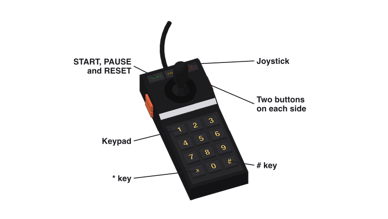

Each controller has two buttons on either side. The **bottom buttons** are the fire buttons for all games; in the FujiNet menu they open and choose. The **top buttons** do different things in different games; in the FujiNet menu they go back. The right or the left can be used.

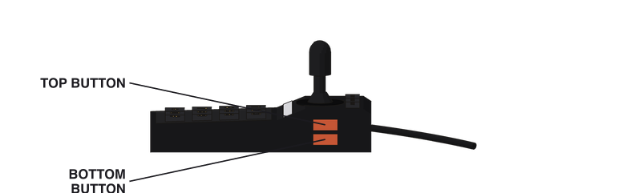

A bar marks the line you are on, and the bottom two lines of every FujiNet screen say which keys do what there.

| In every FujiNet menu | |
|---|---|
| Stick, or keypad **2 4 6 8** | Move. Up and down along the list; left and right turn the page. |
| **Bottom** button or **#** | Open, or choose, the line the bar is on. |
| **Top** button or **\*** | Go back. On the keyboard, erase a letter. |
| **PAUSE** | Rename a host; set a filter; capitals or small letters on the keyboard. |
| **START** | Show INFO; mark a game to copy; look for networks again; accept what you typed. |
| **RESET** | The same as \*. It does not restart anything. |

### Getting Back to the FujiNet Menu

The 5200 has no wire to tell a cartridge to start over, so the way back from any game is to press the console's **POWER** OFF, wait a moment, and press it ON again. The **RESET** key on the controller belongs to the game: it starts that game over.

### Keypad Overlay

All 5200 games can come with keypad overlays. This is the FujiNet menu's: copy it onto a blank overlay, or keep it beside you while you learn.

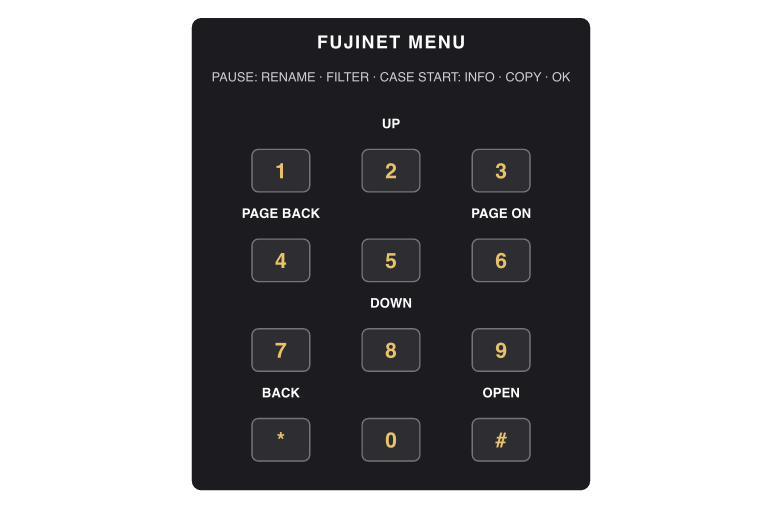

## 6. Join Your Network

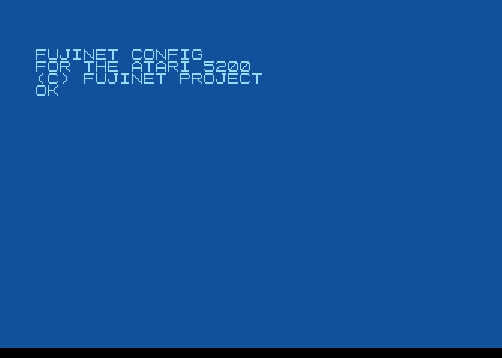

Each time you turn on, FujiNet types its name across the screen. The first time, it has no network to join yet, so it shows **SELECT NETWORK** and lists the WiFi networks it hears. After that it remembers your network and joins it by itself.

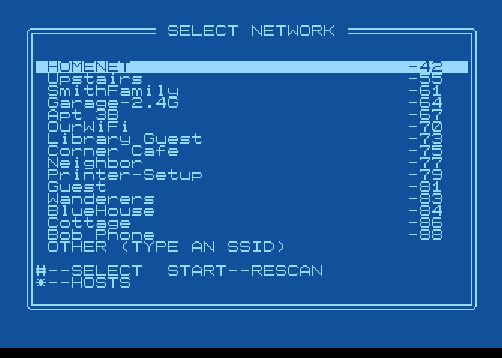

1. Move the bar to your network's name.
2. Press the bottom button (or **#**). The keyboard appears, asking **PASSWORD?**.
3. Spell your network's password.
4. Press **START**. FujiNet tries to join.

The number beside each name is how strongly FujiNet hears it: nearer 0 is stronger. **START** looks again. A hidden network: choose **OTHER (TYPE AN SSID)**. **\*** skips WiFi (games still load from the memory card).

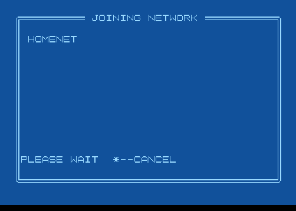 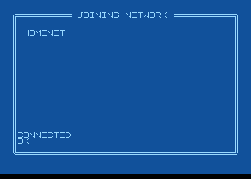

**JOINING NETWORK** can take up to about forty seconds. At **CONNECTED**, the status light turns white and the hosts appear. If it fails (**?CONNECT FAILED**), it goes back to SELECT NETWORK.

### The Keyboard

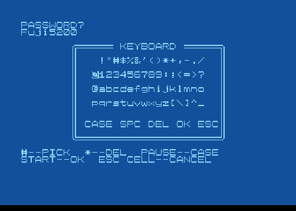

| On the keyboard | |
|---|---|
| Stick or **2 4 6 8** | Move the block. |
| **Bottom** button or **#** | Type the character, or do what its word says. |
| **Top** button, **\*** or **RESET** | Erase the last character. |
| **PAUSE** | Capital letters or small ones (**CASE** too). |
| **START** | Accept (**OK** too). |

**SPC** types a space, **DEL** erases, **ESC** leaves without changing anything. Passwords care about capitals and small letters. The keyboard has no `` ` { | } ~ ``: if your password uses one, set WiFi from a computer ([Section 10](#10-info-and-the-web-control-panel)).

## 7. Hosts and the Browser

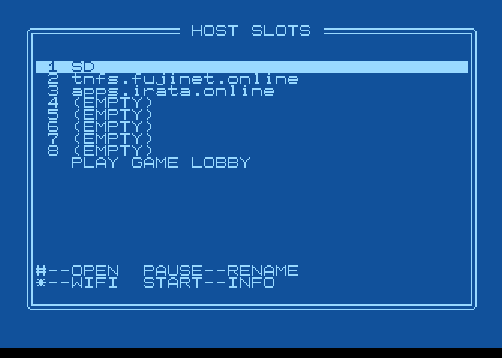

A **host** is a place where games are kept. FujiNet remembers eight. A new FujiNet has **SD** (the memory card), **tnfs.fujinet.online** and **apps.irata.online**. **PLAY GAME LOBBY** opens the Lobby ([Section 11](#11-the-game-lobby)).

| On HOST SLOTS | |
|---|---|
| **Bottom** or **#** | Open the host (or the Lobby). |
| **PAUSE** | Fill in or change the host (keyboard: **HOST NAME?**, up to 31 characters). |
| **START** | INFO. |
| **Top** or **\*** | Choose a WiFi network again. |

| Type this | For |
|---|---|
| `SD` | the memory card |
| `games.local` or `192.168.1.20` | a TNFS server — the usual kind |
| `smb://server/share` | a Windows or Samba share |
| `nfs://server/export` | an NFS share |
| `ftp://server` | an FTP server |
| `http://server/path` | a web server (`https://` too) |

### The Browser

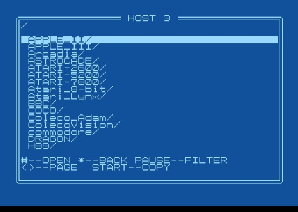 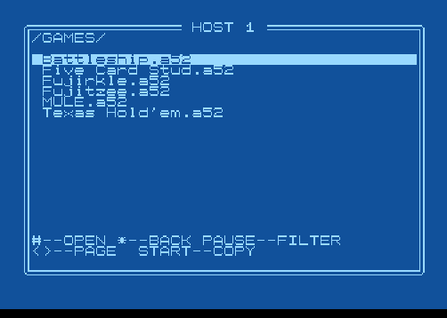

Sixteen names to a page; folders end in `/` and come first.

| In the browser | |
|---|---|
| Stick or **2 8** | Up and down (on into the next page at the ends). |
| Stick or **4 6** | Page back or on. |
| **Bottom** or **#** | Open a folder; load a game. |
| **Top** or **\*** | Back up one folder (at the top, back to HOST SLOTS). |
| **PAUSE** | Filter: `*` any letters, `?` any one letter, capitals and small letters alike. |
| **START** | Copy the game ([Section 9](#9-copying-games)). |

## 8. Loading Games

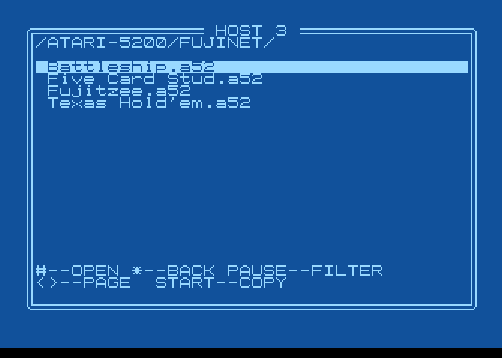 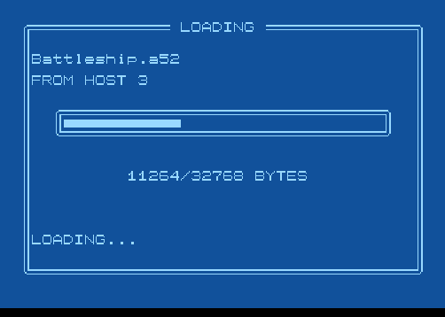

Choose a game and press the bottom button. **LOADING** shows a bar and the bytes; then **BOOTING**, and the game starts as if its own cartridge were in the slot. To leave a game, turn the console OFF and ON.

| Host | Folder | What is there |
|---|---|---|
| apps.irata.online | ATARI-5200 / FUJINET | Battleship, Five Card Stud, Fujitzee, Texas Hold'em |
| apps.irata.online | mule / atari5200 | M.U.L.E. |
| tnfs.fujinet.online | | the FujiNet project's library |

From the memory card: copy games onto a FAT32 microSD card, put it in with the console OFF, open **SD**. From your own computer: run a TNFS server, rename an (EMPTY) host to its address.

### Which Games Will Load

FujiNet knows the whole 5200 library by heart:

| Kind of cartridge | For example |
|---|---|
| 4K to 32K | Kaboom!, Missile Command, Galaxian, River Raid, H.E.R.O. |
| 16K, two chips | Pac-Man, Ms. Pac-Man, Joust, Defender, Qix, Pole Position |
| Bounty Bob Strikes Back (40K) | the one game of its kind |
| Super Cart, 64K or 128K | homebrews, and M.U.L.E. |

Files ending in **.A52**, **.BIN** or **.ROM** load; rename `.CAR` to `.A52`. A game FujiNet does not recognise can have a `.CFG` file beside it, same name, with one line: `mapper=rom`, `mapper=2chips`, `mapper=bbsb` or `mapper=supercart`. Not yet: games over 128K, and 48K images. NTSC only.

| Screen says | What it means |
|---|---|
| ?NOT A CARTRIDGE IMAGE | not a 5200 game, or not .A52/.BIN/.ROM |
| ?LOAD ERROR 01 | larger than 128K |
| ?LOAD ERROR 02 | the file is cut short |
| ?LOAD ERROR 03 | a size that matches no cartridge: try a .CFG |
| ?MOUNT ERROR, ?PATH ERROR | the host or file could not be opened |

## 9. Copying Games

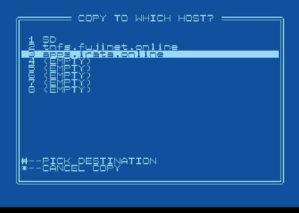 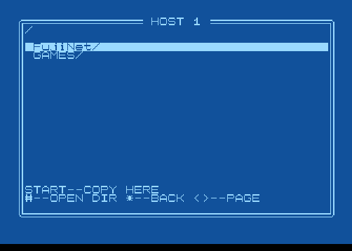

1. In the browser, move to the game and press **START**.
2. **COPY TO WHICH HOST?** — choose the host (**SD** for the memory card) with the bottom button.
3. Open the folder it should go in.
4. Press **START**. **COPYING...**, then **COPIED**.

**\*** cancels. **?COPY ERROR**: the card is full or missing, or the host is read-only (the Internet libraries are). Folders cannot be copied; a `.CFG` file is copied on its own.

## 10. Info and the Web Control Panel

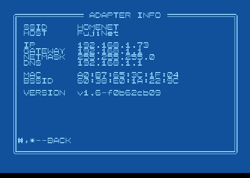

**START** on HOST SLOTS shows **ADAPTER INFO**: SSID, HOST (FujiNet's name), IP, GATEWAY, NETMASK, DNS, MAC, BSSID (your router's), VERSION.

Type FujiNet's **IP** address into a web browser on the same network (or try `http://fujinet.local/`) for the control panel: WiFi, the eight hosts with a real keyboard, files on the memory card, settings and version.

To set WiFi from the memory card, put a file `fnconfig.ini` in its top folder:

```
[WiFi]
enabled=1
SSID=YourNetworkName
passphrase=YourPassword
```

## 11. The Game Lobby

The **FujiNet Game Lobby** lists every network game with a table open right now, on every kind of machine FujiNet works with. Choose **PLAY GAME LOBBY** on HOST SLOTS: FujiNet finds the Lobby's host, **ec.tnfs.io** (adding it to the first empty host, or the eighth if all are full), and loads the Lobby.

> **NOTE:** The Lobby for the 5200 is being finished now. Until it is ready, load the network games from the browser ([Section 8](#8-loading-games)): each has its own list of tables. When a game is asked to go back to the Lobby, it goes back to the FujiNet menu instead.

FujiNet keeps one player name (up to eight letters and numbers) for all its games; the first game you play asks for it. The **AI Rooms** seat you with robot players.

## 12. 5 Card Stud

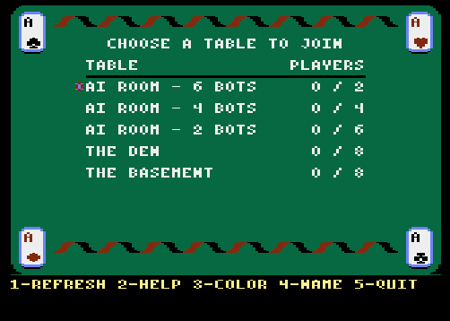 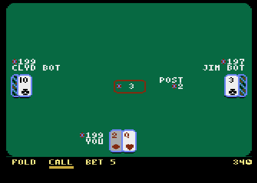

Up to eight players; one card face down and four face up; the best poker hand wins. Load *ATARI-5200 / FUJINET / Five Card Stud.a52*. **The Basement** and **The Den** are for people; the **AI Rooms** have two, four or six robots.

| 5 Card Stud | |
|---|---|
| Stick | Choose a table; move the bar along your moves. |
| **Bottom**, **#** or **START** | Sit down; make the move. |
| **Top**, **\*** or **RESET** | The table menu: **5** quit table, **2** how to play, **3** table colour, **RESET** keep playing. |
| **1** · **2** or **PAUSE** · **3** · **4** · **5** | List again · how to play · colour · name · leave (table list). |

Everyone antes 1; the lowest showing card posts 2; bets are 5 early and 10 later, three raises a round; the best hand at the showdown wins. Everyone starts with 200 chips and has about forty seconds a move.

## 13. Texas Hold'em

 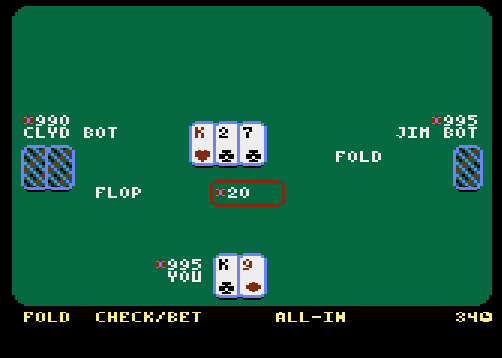

Two cards of your own, five shared. Load *ATARI-5200 / FUJINET / Texas Hold'em.a52*; tables as in 5 Card Stud. **Bottom**, **#** or **START** sit and move; **top**, **\***, **PAUSE** or **RESET** open the table menu (**PAUSE** there goes back). Blinds 5 and 10; flop, turn and river, each with a betting round; best five of seven wins. Everyone starts with 1,000 chips.

## 14. Battleship

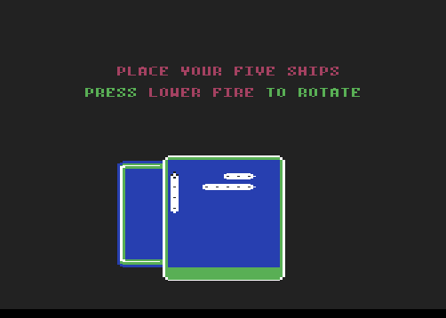 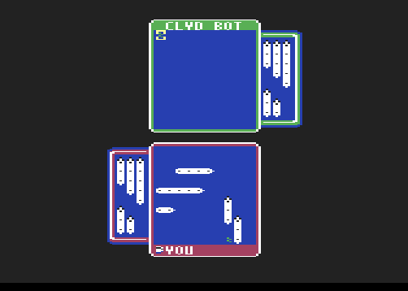

Two to four fleets on one ocean; every shot lands on every enemy board at once. Load *ATARI-5200 / FUJINET / Battleship.a52*. The **AI** tables give you one to three robot admirals. Press the bottom button when ready.

| Battleship | |
|---|---|
| Stick | Move a ship; aim. |
| **Top** or **1** | Turn a ship (the screen says **LOWER FIRE**); in battle, ask the server now. |
| **Bottom**, **#** or **START** | Place a ship; fire. |
| **PAUSE** or **\*** | Game menu: **5** quit, **2** how to play, **3** sound; the bottom button closes it. |

Five ships (5, 4, 3, 3, 2 squares), already laid out: press the bottom button five times to keep them. About 45 seconds a turn.

## 15. Fujitzee

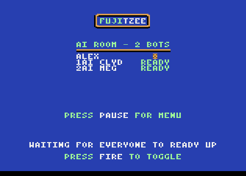 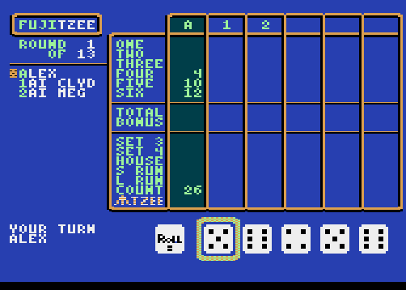

Five dice, three rolls a turn, thirteen boxes. Load *ATARI-5200 / FUJINET / Fujitzee.a52*. Press the bottom button to toggle *ready*.

| Fujitzee | |
|---|---|
| Stick or **2 4 6 8** | Along the dice; up onto the card; up and down the boxes. |
| **Bottom** or **#** | Roll, keep a die, score a box; ready. |
| **PAUSE** or **\*** | Menu: **RESET** quit table, **1** how to play, **0** sound, **PAUSE** keep playing. |
| **Top** or **1** | How to play. |
| **START** / **RESET** | At the table list: list again / leave. |

one–six: total of that number; bonus 35 at 63; set 3, set 4: total of all; house 25; s run 30; l run 40; count: total of all; fujitzee 50.

## 16. Fujirkle

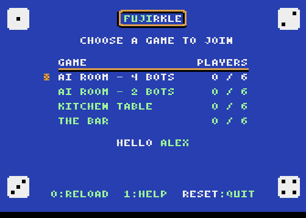 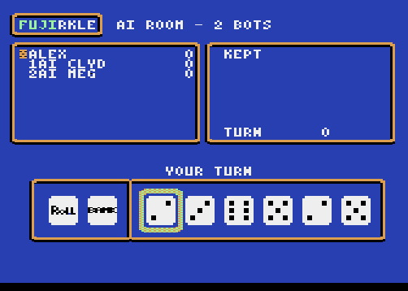

> **NOTE:** Fujirkle for the 5200 is being finished, and is not yet in the library on apps.irata.online.

Roll six dice, set aside the ones that score, then roll on or bank — roll nothing that scores and lose the turn. Set aside all six: hot dice, roll all six again. First to 10,000 starts the final round.

| Fujirkle | |
|---|---|
| Stick or **2 4 6 8** | Along the dice; up jumps to ROLL, down to BANK. |
| **Bottom**, **#** or **5** | Roll, keep a die, bank; ready. |
| **START**, **PAUSE** or **\*** | Menu: **RESET** quit table, **1** how to play, **3** sound, **START** resume. |
| **0** / **RESET** | At the table list: list again / leave. |

Single 1: 100 · single 5: 50 · three of a kind: 100 × the number (three 1s: 1,000) · four, five, six of a kind: ×2, ×4, ×8 · straight 1–6: 1,500 · three pairs: 1,500.

## 17. M.U.L.E.

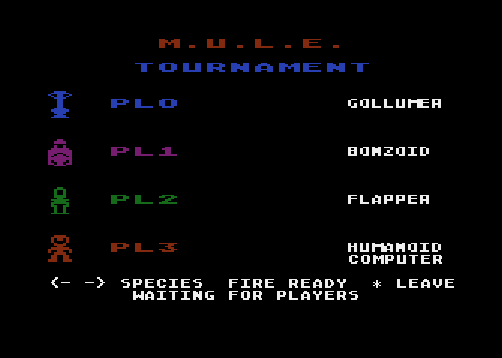 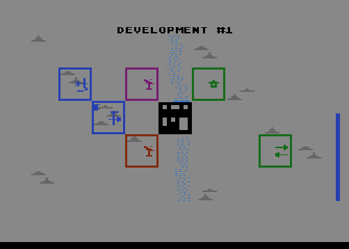

Four colonists on Irata, on any FujiNet machine, the computer in any empty seat. Load *mule / atari5200 / mule.a52*; the public colony is **Planet IRATA**.

| M.U.L.E. | |
|---|---|
| Stick | Walk; choose; bid; declare. |
| **Bottom** | The button: start, join, ready, claim, install... |
| **START** | End your turn; finish your name. |
| **Top** | Rub out a letter (name screen). |
| **0** · **#** | Sit out a declaration · sound. |
| **\*** | Leave the table (twice: **LEAVE GAME? \* AGAIN: YES**); at the table list, back to the FujiNet menu. |

The whole game is in the *M.U.L.E. Player's Guide*.

## 18. Maintaining Your FujiNet Cartridge

- Turn the console's POWER OFF before putting the cartridge in or taking it out. Do not force it.
- Do not push anything into the service holes. Push the memory card straight in; do not pry it.
- Use only a USB-C phone charger or a computer's USB port.
- Keep it dry and out of great heat; clean it with a soft, slightly damp cloth.

New firmware, and how to load it, is announced at **fujinet.online**. It does not change your hosts or WiFi.

## 19. Troubleshooting Checklist

| Symptom | Probable cause and remedy |
|---|---|
| No picture | POWER not ON; cartridge not seated (OFF, push in firmly, ON); put in while ON. |
| Picture jumps when WiFi connects; menu starts over | Not enough power: plug a USB-C charger in before turning on. Always on a four-port. |
| The controller does nothing | Not in jack 1; plug not fully home. |
| The stick does nothing but the keypad works | Use keypad 2 4 6 8 in the menu; tell the FujiNet project. |
| My network is not listed | Too far away; 5 GHz only (FujiNet needs 2.4 GHz); hidden — use OTHER. |
| ?CONNECT FAILED / ?UNABLE TO CONNECT | Wrong password (PAUSE switches case); or set WiFi from a computer or the card. |
| A host shows nothing, ?HOST ERROR / ?OPEN ERROR | Name misspelled; server down; SD: no card or not FAT32. |
| ?NOT A CARTRIDGE IMAGE | Name not .A52/.BIN/.ROM (rename .CAR); not a 5200 game. |
| ?LOAD ERROR 01, 02, 03 | Over 128K; damaged; no matching kind ([Section 8](#8-loading-games)). |
| Garbled or rolling game | A PAL game; or try a .CFG. |
| Cannot get back to the menu | Turn the console OFF and ON. |
| LOBBY NOT AVAILABLE | The 5200 Lobby is being finished; load games from the browser. |
| ?READ ERROR 01 / 02 | 01: the cartridge's two computers could not talk — OFF and ON. 02: FujiNet took too long — try again. |

Help: **fujinet.online** · **github.com/FujiNetWIFI** · **discord.gg/7MfFTvD**

## 20. Parts List

| | |
|---|---|
| Board | FujiNet-5200 Rev0 (`fujinet-hardware`, ATARI-5200/FujiNet-5200-Rev0) |
| Game chip | RP2354B (RP2350 with 2 MB flash) |
| Network chip | ESP32-S3-WROOM-1, 16 MB flash, 8 MB PSRAM |
| Bus buffer | 74HCT541 |
| WiFi | 802.11 b/g/n, 2.4 GHz |
| Memory card | microSD, push-push, FAT32 |
| USB | USB-C: power, and firmware loading |
| Lights | status (white / orange); game (red) |
| Buttons | RESET; BOOTSEL, S3 EN, S3 BOOT (service) |
| Consoles | CX5200, four-port and two-port; NTSC |
| Games | up to 128K; .A52, .BIN or .ROM |
| Cartridge shell | to come; the drawings here are the manual's own |

## Quick Reference

| Screen | Stick or 2 4 6 8 | Bottom or # | Top or \* | PAUSE · START |
|---|---|---|---|---|
| SELECT NETWORK | choose | this one | skip WiFi | — · look again |
| Keyboard | move | type | erase | case · OK |
| HOST SLOTS | choose | open | WiFi | rename · INFO |
| Browser | choose; left/right page | open · load | up a folder | filter · copy |
| COPY TO … | choose | pick · open | cancel · back | — · copy here |
| 5 Card Stud, Hold'em | choose; your move | sit · move | menu | help or menu · move |
| Battleship | aim; move a ship | place · fire | turn a ship | menu · fire |
| Fujitzee | dice; the card | roll · keep · score | help | menu · list again |
| Fujirkle | dice; up ROLL, down BANK | roll · keep · bank | help | menu · menu |
| M.U.L.E. | walk · choose · bid | the button | rub out | — · end turn |
| Console POWER | OFF and ON: back to the FujiNet menu, from any game. ||||
| RESET key | In the menu, the same as \*; in a game, the game's own. ||||

---

*FujiNet is not affiliated with Atari. "Atari" and "5200" are trademarks of their owner; "M.U.L.E." is a trademark of its owner. © 2026 the FujiNet Project, CC BY-SA 4.0.*
