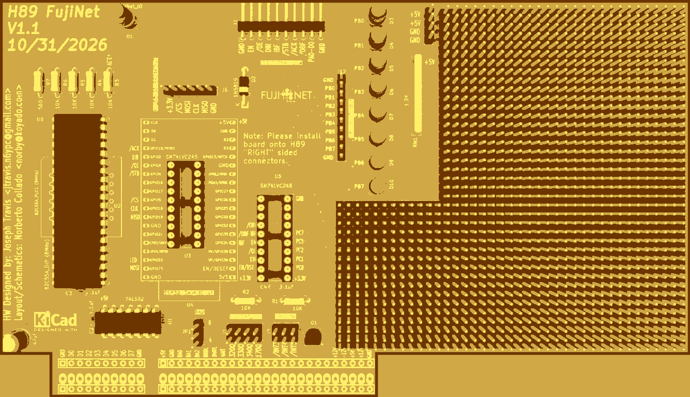
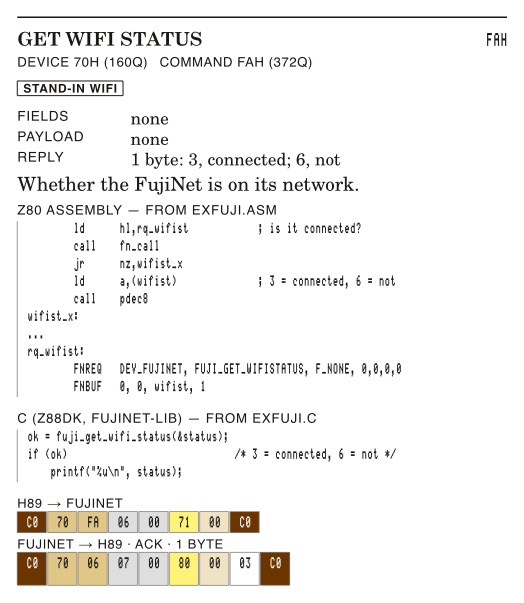
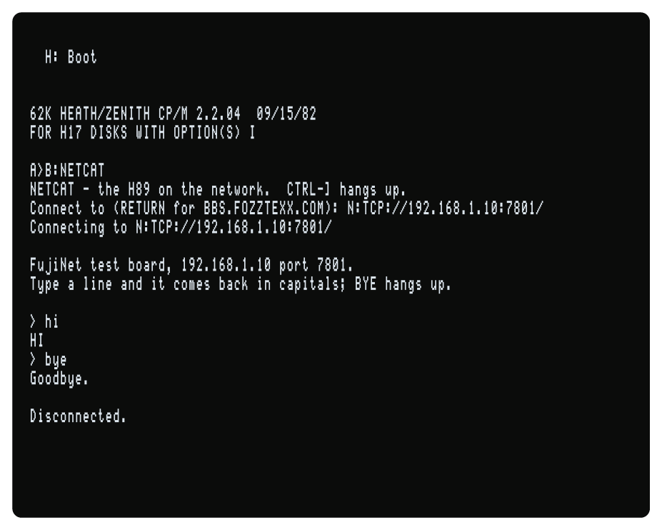
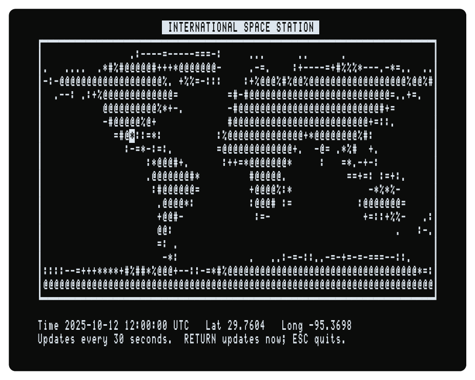
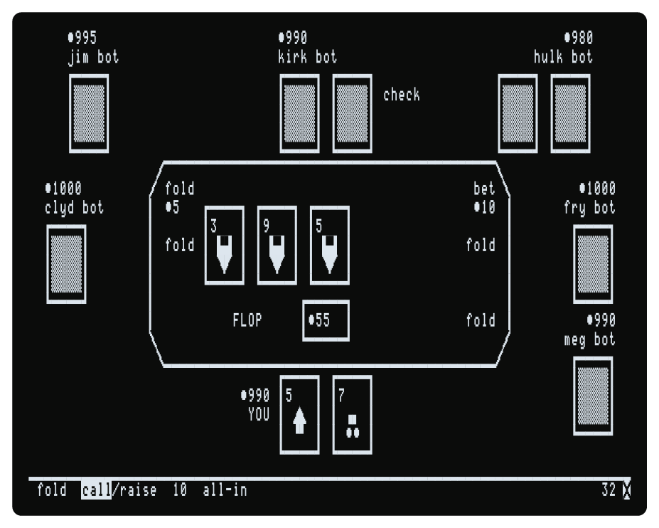

# FujiNet Programmer's Manual for the Heathkit H89

*How to write programs for the H89 FujiNet card: the card's ports and the FujiBus protocol, Z80 assembly for HDOS and CP/M from one source, 8080 assembly on the H89 itself, C with z88dk and fujinet-lib, every command of every device, the 28 network protocols, and whole programs — NETCAT, NGET and NPUT, an ISS tracker, and three network games.*



The printed edition — about 250 pages, styled after Heath's 1979 *H88 Operation Manual* — is in the [fujinet-manuals](https://github.com/FujiNetWIFI/fujinet-manuals) repository under `h89/programmers-handbook/`, with every program in it. This page is the short version: what you need to start, and the reference tables.

Everything in the book was built and run on FujiNet Go H89 under HDOS 2.0 and CP/M 2.2.04, with the emulated card connected to fujinet-pc built from the same firmware as the card. The bytes printed with each command were recorded on the bus as the examples ran. Nothing has been run on a real card.

---

## Contents

1. [The Software This Describes](#1-the-software-this-describes)
2. [The Card, as a Program Sees It](#2-the-card-as-a-program-sees-it)
3. [The FujiBus Protocol](#3-the-fujibus-protocol)
4. [Assembly Language](#4-assembly-language)
5. [C with z88dk](#5-c-with-z88dk)
6. [Command Quick Reference](#6-command-quick-reference)
7. [Network Protocols](#7-network-protocols)
8. [fujinet-lib on the H89](#8-fujinet-lib-on-the-h89)
9. [The Programs](#9-the-programs)
10. [Errata](#10-errata)

---

## 1. The Software This Describes

| Program | Version |
|---|---|
| Firmware | fujinet-firmware, branch `h89-disk-fixes`, 7ab84ae64 (v1.6) |
| fujinet-lib | branch `h89-setup-after-reset`, d08f584 (the H89 is not yet in a release); Chapters 13-19 and the library's tests ran with 9e6d4dd |
| z88dk | v2.4-1231 (3bd06cad56) |
| FujiNet Go H89 | 51f411d (resets the 82C55A as a real H89 does); Chapters 13-19 and the library's tests ran on v0.1.0-3 (8dc059d) |

The FujiNet for the H89 is new and its software is still changing. Where the firmware or the library does something it should not, the book says so in a WARNING with what to do instead; the [errata](#10-errata) list every case, cited to its line of source.

---

## 2. The Card, as a Program Sees It

Four ports, a handshake and a clock. No memory, no interrupt, no ROM.

| Port | Octal | Use |
|---|---|---|
| D0H | 320Q | Port A of the 82C55A, in mode 2: every byte to and from the FujiNet |
| D1H | 321Q | Port B: wired to nothing; holds A5H once the card is set up |
| D2H | 322Q | Port C: status (read) and control (written) |
| D3H | 323Q | The 82C55A's control register |

| Bit of D2H | Name | Meaning |
|---|---|---|
| 80H | /OBF | 0 while a byte the H89 wrote waits for the ESP32 |
| 20H | IBF | 1 while a byte from the ESP32 waits for the H89 |
| 04H | EN | 1 = the ESP32 may run (after a reset it can read 1 before anything set the card up) |
| 02H | /OE | 0 = the bus transceiver is on |
| 01H | DIR | 1 = toward the ESP32, 0 = toward the H89 |

- **Starting it.** Unless port B (D1H) reads A5H and EN is 1, write C0H (mode 2) to D3H and, with the very next instruction, raise EN with PC1 high (006 to D2H); wait 200 ms, write A5H to D1H, read D0H once, then set /OE = 0 and DIR = 0 with bit set/reset commands (02H, 00H to D3H). After a reset EN can read 1 while port A is not in mode 2, so don't trust EN alone; and never leave EN low after a mode word while the FujiNet is running.
- **Sending.** DIR = 1; for each byte wait for /OBF = 1, then write D0H. After the last, wait for /OBF = 1 and set DIR = 0.
- **Receiving.** DIR = 0; wait for IBF = 1, read D0H.
- **Time.** The 2 ms tick word is at 201BH under HDOS, 000BH under Heath CP/M.
- **Limits.** The firmware waits only **100 ms** between the bytes of a request; a program that pauses longer loses the request. It waits 1 s for each reply byte to be taken. fujinet-lib waits 15 s for a reply byte, and forever to send one.
- **No interrupts.** A program asks; data arriving on a network channel waits until the program asks STATUS and reads it.

---

## 3. The FujiBus Protocol

A request and a reply, each a SLIP frame: `C0`, the packet, `C0`, with C0H in the packet sent as `DB DC` and DBH as `DB DD`. **Send exactly one C0 before the packet.**

| Byte | Request | Reply |
|---|---|---|
| 0 | device | the device answering (00 if it does not exist) |
| 1 | command | ACK 06H or NAK 15H |
| 2, 3 | length of the whole packet, low first | the same |
| 4 | checksum | checksum |
| 5 | descriptor: which fields follow | 00 |
| 6 … | fields, then the payload | data (an ACK only) |

- **Checksum.** Add every byte of the packet, the checksum byte counted as 0, with the carry out of each addition added back in (end-around carry). `70 FA 06 00 ?? 00` sums to 71H.
- **Descriptor.** 0 none; 1–4 that many one-byte fields; 5 one word; 6 two words; 7 one long (low byte first). Bit 7 chains another descriptor. The firmware ignores bits 3–6 (fujinet-lib sends its own flags there, 08H and 10H).
- **Send every field a command takes.** A missing field does not NAK: the firmware stops (the ESP32 restarts; fujinet-pc exits).
- **No reply** for a bad checksum or length, a gap of over 100 ms in a request, FUJI_RESET, the printer when it is off, and the modem (its answers are bare bytes).

| Device | Number |
|---|---|
| The FujiNet | 70H |
| Disk drives (slots 0–7) | 31H–38H |
| Network channels | 71H–78H |
| Clock | 45H |
| Printer | 40H |
| Modem | 50H |

Each command in the book has a card like this one, with a Z80 example, a C example and the bytes recorded on the bus, shaded by their part of the frame:



---

## 4. Assembly Language

Neither HDOS nor CP/M came with a Z80 assembler (Heath's ASM and DRI's ASM are 8080 only). The book assembles on a modern computer with **z88dk-z80asm**, one source for both systems:

```
z88dk-z80asm -b -DHDOS -Isrc/asm/inc -oFNHELLO.ABS src/asm/hello/fnhello.asm
z88dk-z80asm -b -DCPM  -Isrc/asm/inc -oFNHELLO.COM src/asm/hello/fnhello.asm
```

The book's small library (`src/asm/inc/`) does the rest: `os.inc` (the .ABS header at 2278H for HDOS, or 0100H and a stack for CP/M; console, files, the command line), `card.inc` (`card_on`, `card_present`), `fujibus.inc` (`fn_call`), `con.inc` (printing numbers and bytes). A request is two lines of data:

```
rq_config:
        FNREQ   DEV_FUJINET, FUJI_GET_ADAPTERCONFIG, F_NONE, 0,0,0,0
        FNBUF   0, 0, cfg, 140          ; no payload; 140 bytes back to cfg
...
        ld      hl,rq_config
        call    fn_call                 ; Z = ACK, BC = reply length
```

The book's Chapter 5 shows the same on the H89 itself with Heath's ASM (HDOS) and DRI's ASM and LOAD (CP/M), in 8080 code.

---

## 5. C with z88dk

Build fujinet-lib from source: `make h89-hdos/r2r h89-cpm/r2r` (use the `/r2r` targets).

**CP/M:**

```
zcc +cpm -create-app -D__H89__ -I$FNLIB/include \
    -L$FNLIB/r2r/h89-cpm -lfujinet.h89-cpm.lib -o HELLO hello.c
```

**HDOS:**

```
zcc +hdos -startup=3 -Cz--abs -create-app -D__H89__ \
    -pragma-define:CRT_ORG_CODE=0x2A80 -pragma-define:REGISTER_SP=0x2A80 \
    -pragma-define:CRT_ENABLE_COMMANDLINE=0 \
    -pragma-define:CLIB_DISABLE_FGETS_CURSOR=1 \
    -I$FNLIB/include -L$FNLIB/r2r/h89-hdos -lfujinet.h89-hdos.lib -o HELLO hello.c
```

- `-D__H89__` is required, even for CP/M.
- Give the library's name in full, `.lib` and all: the dot in it stops z88dk adding `.lib`.
- z88dk's HDOS default load address, 4480H, is the split-octal 042.200 read as one octal number; HDOS loads at 2280H. The book loads at 2A80H with the stack just below, as FujiNet CONFIG does.
- z88dk's HDOS start-up code takes the entry stack pointer back from the wrong stack, so `argv[]` is damaged. Turn its command-line handling off (`CRT_ENABLE_COMMANDLINE=0`) and split the command line yourself (the book's `hdosargs.c`).
- HDOS maps console output to capitals unless told not to: `.CONSL` (the book's `h89con.c`, `con_init(0)`).
- HDOS and CP/M both capitalise a typed command line; a program that needs lower case (a URL's path) should ask for it.

---

## 6. Command Quick Reference

Every command the H89's FujiNet answers. Fields: the size of each field, in order (1 byte, 2 word, 4 long). Payload and reply: their length, or ACK for a reply with no data. The book gives each a card with a Z80 example, a C example and the bytes.

### The FujiNet device (70H)

| Command | No. | Fields | Payload | Reply |
|---|---|---|---|---|
| `FUJI_BASE64_DECODE_COMPUTE` | CBH | -- | -- | ACK |
| `FUJI_BASE64_DECODE_INPUT` | CCH | 2 | len | ACK |
| `FUJI_BASE64_DECODE_LENGTH` | CAH | -- | -- | 4 |
| `FUJI_BASE64_DECODE_OUTPUT` | C9H | 2 | -- | len |
| `FUJI_BASE64_ENCODE_COMPUTE` | CFH | -- | -- | ACK |
| `FUJI_BASE64_ENCODE_INPUT` | D0H | 2 | len | ACK |
| `FUJI_BASE64_ENCODE_LENGTH` | CEH | -- | -- | 4 |
| `FUJI_BASE64_ENCODE_OUTPUT` | CDH | 2 | -- | len |
| `FUJI_CLOSE_APPKEY` | DBH | -- | -- | ACK |
| `FUJI_CLOSE_DIRECTORY` | F5H | -- | -- | ACK |
| `FUJI_CONFIG_BOOT` | D9H | 1 | -- | ACK |
| `FUJI_COPY_FILE` | D8H | 1,1 | src\|dst | ACK |
| `FUJI_DEVICE_READY` | 00H | -- | -- | 512 |
| `FUJI_GENERATE_GUID` | BBH | -- | -- | 37 |
| `FUJI_GET_ADAPTERCONFIG` | E8H | -- | -- | 140 |
| `FUJI_GET_ADAPTERCONFIG_EXTENDED` | C4H | -- | -- | 240 |
| `FUJI_GET_DEVICE_FULLPATH` | DAH | 1 | -- | 256 |
| `FUJI_GET_DIRECTORY_POSITION` | E5H | -- | -- | 2 |
| `FUJI_GET_HOST_PREFIX` | E0H | 1 | -- | 256 |
| `FUJI_GET_SCAN_RESULT` | FCH | 1 | -- | 34 |
| `FUJI_GET_SSID` | FEH | -- | -- | 97 |
| `FUJI_GET_WIFISTATUS` | FAH | -- | -- | 1 |
| `FUJI_GET_WIFI_ENABLED` | EAH | -- | -- | 1 |
| `FUJI_HASH_CLEAR` | C2H | -- | -- | ACK |
| `FUJI_HASH_COMPUTE` | C7H | 1 | -- | ACK |
| `FUJI_HASH_COMPUTE_NO_CLEAR` | C3H | 1 | -- | ACK |
| `FUJI_HASH_INPUT` | C8H | 2 | len | ACK |
| `FUJI_HASH_LENGTH` | C6H | 1 | -- | 1 |
| `FUJI_HASH_OUTPUT` | C5H | 1 | -- | length |
| `FUJI_MOUNT_ALL` | D7H | -- | -- | ACK |
| `FUJI_MOUNT_HOST` | F9H | 1 | -- | ACK |
| `FUJI_MOUNT_IMAGE` | F8H | 1,1 | -- | ACK |
| `FUJI_NEW_DISK` | E7H | -- | 262 | NAK |
| `FUJI_OPEN_APPKEY` | DCH | -- | 6 | ACK |
| `FUJI_OPEN_DIRECTORY` | F7H | 1 | up to 256 | ACK |
| `FUJI_QRCODE_ENCODE` | BDH | 1,1,1 | -- | ACK |
| `FUJI_QRCODE_INPUT` | BCH | 2 | len | ACK |
| `FUJI_QRCODE_LENGTH` | BEH | 1 | -- | 4 |
| `FUJI_QRCODE_OUTPUT` | BFH | 2 | -- | len |
| `FUJI_RANDOM_NUMBER` | D3H | -- | -- | 4 |
| `FUJI_READ_APPKEY` | DDH | -- | -- | 2+n |
| `FUJI_READ_DEVICE_SLOTS` | F2H | -- | -- | 304 |
| `FUJI_READ_DIR_ENTRY` | F6H | 1,1 | -- | field 1 |
| `FUJI_READ_HOST_SLOTS` | F4H | -- | -- | 256 |
| `FUJI_RESET` | FFH | -- | -- | none |
| `FUJI_SCAN_NETWORKS` | FDH | -- | -- | 1 |
| `FUJI_SET_BOOT_MODE` | D6H | 1 | -- | ACK |
| `FUJI_SET_DEVICE_FULLPATH` | E2H | 1,1,1 | up to 256 | ACK |
| `FUJI_SET_DIRECTORY_POSITION` | E4H | 2 | -- | ACK |
| `FUJI_SET_HOST_PREFIX` | E1H | 1 | up to 256 | ACK |
| `FUJI_SET_SSID` | FBH | 1 | 97 | ACK |
| `FUJI_STATUS` | 53H | 1 | -- | 4 |
| `FUJI_UNMOUNT_HOST` | E6H | 1 | -- | ACK |
| `FUJI_UNMOUNT_IMAGE` | E9H | 1 | -- | ACK |
| `FUJI_WRITE_APPKEY` | DEH | -- | <= 64 | ACK |
| `FUJI_WRITE_DEVICE_SLOTS` | F1H | -- | 304 | ACK |
| `FUJI_WRITE_HOST_SLOTS` | F3H | -- | 256 | ACK |

### Network channels (71H-78H)

| Command | No. | Fields | Payload | Reply |
|---|---|---|---|---|
| `NET_ACCEPT` | 41H | -- | -- | ACK |
| `NET_CHDIR` | 2CH | -- | path | ACK |
| `NET_CLOSE` | 43H | -- | -- | ACK |
| `NET_CLOSE_CLIENT` | 63H | -- | -- | ACK |
| `NET_DELETE` | 21H | 1,1 | spec | ACK |
| `NET_GETCWD` | 30H | -- | -- | prefix |
| `NET_GET_REMOTE` | 72H | -- | -- | 256 |
| `NET_LOCK` | 23H | 1,1 | spec | ACK |
| `NET_MKDIR` | 2AH | 1,1 | spec | ACK |
| `NET_OPEN` | 4FH | 1,1 | spec | ACK |
| `NET_PARSE` | 50H | -- | -- | ACK |
| `NET_PASSWORD` | FEH | -- | text | ACK |
| `NET_QUERY` | 51H | -- | pointer | ACK |
| `NET_READ` | 52H | 2 | -- | <= field |
| `NET_RENAME` | 20H | 1,1 | spec,new | ACK |
| `NET_RMDIR` | 2BH | 1,1 | spec | ACK |
| `NET_SEEK` | 25H | 4 | -- | ACK |
| `NET_SET_DESTINATION` | 44H | -- | N:host:port | ACK |
| `NET_SET_EOL` | 4CH | -- | 1-2 | ACK |
| `NET_SET_HTTP_MODE` | 4DH | 1,1 | -- | ACK |
| `NET_SET_INT_RATE` | 5AH | 1 | -- | ACK |
| `NET_SET_PARAMETER` | FBH | 1,1 | -- | ACK |
| `NET_SET_PARSER` | FCH | 1,1 | -- | ACK |
| `NET_STATUS` | 53H | -- | -- | 4 |
| `NET_TELL` | 26H | -- | -- | 4 |
| `NET_TRANSLATION` | 54H | 1,1 | -- | ACK |
| `NET_UNLOCK` | 24H | 1,1 | spec | ACK |
| `NET_USERNAME` | FDH | -- | text | ACK |
| `NET_WRITE` | 57H | 2 | field | ACK |

### Disk drives (31H-38H)

| Command | No. | Fields | Payload | Reply |
|---|---|---|---|---|
| `DISK_FORMAT` | 21H | -- | -- | 128 |
| `DISK_FORMAT_MEDIUM` | 22H | -- | -- | 128 |
| `DISK_PERCOM_READ` | 4EH | -- | -- | 12 |
| `DISK_PERCOM_WRITE` | 4FH | -- | 12 | ACK |
| `DISK_PUT` | 50H | 4 | 512 | ACK |
| `DISK_READ` | 52H | 4 | -- | 512 |
| `DISK_STATUS` | 53H | 1 | -- | 4 |
| `DISK_WRITE` | 57H | 4 | 512 | ACK |

### Clock (45H)

| Command | No. | Fields | Payload | Reply |
|---|---|---|---|---|
| `APETIME_GETTIME` | 93H | 1 | -- | 6 |
| `APETIME_GETTZTIME` | 9AH | 1 | -- | 6 |
| `APETIME_GETTZ_LEN` | 4CH | -- | -- | 1 |
| `APETIME_GET_GENERAL` | 47H | -- | -- | text |
| `APETIME_GET_ISO_LOCAL` | 49H | 1 | -- | 25 |
| `APETIME_GET_ISO_UTC` | 5AH | 1 | -- | 25 |
| `APETIME_GET_PRODOS` | 50H | 1 | -- | 4 |
| `APETIME_GET_SIMPLE_HUNDREDTHS` | 4DH | 1 | -- | 8 |
| `APETIME_GET_SOS` | 53H | 1 | -- | 19 |
| `APETIME_SETTZ` | 99H | 1 | text | ACK |
| `APETIME_SETTZ_ALT` | 74H | 1 | text | ACK |
| `APETIME_SETTZ_ALT2` | 54H | 1 | -- | 7 |

### Printer (40H)

| Command | No. | Fields | Payload | Reply |
|---|---|---|---|---|
| `PRINTER_PUT` | 50H | -- | text | ACK |
| `PRINTER_STATUS` | 53H | 1 | -- | 4 |
| `PRINTER_WRITE` | 57H | 1 | text | ACK |

### Modem (50H)

| Command | No. | Fields | Payload | Reply |
|---|---|---|---|---|
| `MODEM_AUTOANSWER` | 4FH | 1 | -- | none |
| `MODEM_BAUDRATELOCK` | 4EH | 1,1 | -- | none |
| `MODEM_CONFIGURE` | 42H | 1 | -- | none |
| `MODEM_CONTROL` | 41H | 1 | -- | none |
| `MODEM_LISTEN` | 4CH | 2 | -- | none |
| `MODEM_SET_DUMP` | 44H | 1 | -- | none |
| `MODEM_STATUS` | 53H | 1 | -- | 2 |
| `MODEM_STREAM` | 58H | 1 | -- | 9 |
| `MODEM_UNLISTEN` | 4DH | -- | -- | none |
| `MODEM_WRITE` | 57H | 1 | bytes | none |


---

## 7. Network Protocols

A network channel opens whatever its devicespec names: `N:SCHEME://host/path`. All 28 schemes are in the H89's firmware and in fujinet-pc.

| Scheme | What it reaches |
|---|---|
| `CLIPBOARD` | FujiNet clipboard: read N:CLIPBOARD:///0..9 (0 = current), write replaces it on CLOSE, append (aux1 9) adds |
| `CPM` | embedded RunCPM Z80 CP/M 2.2 emulator: READ = its console output, WRITE = keystrokes; one shared instance |
| `GCAL` | Google Calendar list/DAY/WEEK/MONTH views as text; RS232 default line width 80 |
| `GDRIVE` | Google Drive files/folders, OAuth2 device grant from config; writes uploaded at CLOSE |
| `GMAIL` | Gmail folders, messages, attachments; aux1 8 = compose/reply; uses the Google Drive OAuth grant |
| `ICAL / WEBCAL / ICALH` | iCalendar (RFC 5545) feed views; ICAL/WEBCAL fetch over https, ICALH over http |
| `IMAPS` | IMAP over TLS mailbox (default port 993); credentials from URL or NET_USERNAME/NET_PASSWORD |
| `ONEDRIVE` | Microsoft OneDrive via Graph, OAuth through auth.fujinet.online relay |
| `TCP` | raw TCP: 'TCP://host:port' client (port default 23), 'TCP://:port' listener with ACCEPT/CLOSE_CLIENT, 'TCP://' empty socket |
| `UDP` | UDP datagrams; port required; SET_DESTINATION/GET_REMOTE |
| `TEST` | diagnostic: READ returns a fixed test sentence, writes are logged |
| `TELNET` | TCP with libtelnet option negotiation; ACCEPT/CLOSE_CLIENT apply. The telnet state is one file-static pointer shared by all units |
| `TNFS` | TNFS file server: read/write/append/rw, directories, all six fs commands, SEEK/TELL |
| `FTP` | FTP files and directories; fs commands are stubs that ACK |
| `HTTP / HTTPS` | HTTP(S) client: GET/POST/PUT/DELETE, request/response headers, WebDAV directory (PROPFIND), MOVE, MKCOL, Range seek |
| `WS` | WebSocket client |
| `WSS` | WebSocket over TLS |
| `SSH` | interactive SSH session (libssh) |
| `SFTP` | files over SFTP (libssh sftp), all fs commands, seek |
| `SSH.KEYGEN` | generates /.ssh/id_ed25519(.pub) on the SD card; READ returns a status text |
| `SSH.COPYID` | appends the FujiNet public key to ~/.ssh/authorized_keys on a remote host |
| `SMB` | SMB2/3 shares (libsmb2): files, directories, rename/delete/mkdir/rmdir, seek |
| `NFS` | NFS exports (libnfs): files, directories, fs commands (lock/unlock no-ops), seek |
| `S3` | Amazon S3 / compatible object storage, SigV4, path-style |
| `SD` | FujiNet's own SD card (on PC: the configured SD directory): files, directories, fs commands (no lock/unlock), seek |

---

## 8. fujinet-lib on the H89

Most functions send one command and return `true` (ACK) or an `FN_ERR`. These need care on the H89:

| Function | On the H89 |
|---|---|
| `clock_get_time` | The library writes a NUL after the reply, binary formats too, so the buffer must be one byte longer than the reply: 8 bytes for SIMPLE_BINARY, 5 for PRODOS_BINARY, 7 for APETIME_BINARY, 26 for TZ_ISO_STRING and UTC_ISO_STRING, 20 for APPLE3_SOS_BINARY, 9 for SIMPLE_BINARY_WITH_HUNDREDTHS. SIMPLE_BINARY is command 54H, which the firmware calls APETIME_SETTZ_ALT2 but answers with the time. |
| `clock_get_time_common` | Buffer one byte longer than the reply, as for clock_get_time(). With no alternate zone set, alt true gives the system zone's time. |
| `clock_get_time_tz` | The alternate zone stays set after the call and is used by every later request with alt true. The FujiNet ACKs the zone before it looks at it: a bad zone is dropped without a word, and the time comes back in the zone that was there before. Buffer one byte longer than the reply. |
| `clock_get_tz` | The FujiNet decides how many bytes come back, not you: the buffer must hold the longest zone that could be set, NUL and all. 64 bytes is plenty for a real zone. |
| `clock_set_tz` | ACKed before it is checked: a zone holding a control character (a CR on the end, say) is thrown away and FN_ERR_OK still comes back. Read it back with clock_get_tz() if it matters. |
| `fuji_base64_decode_compute` | Encoding and decoding share one buffer in the FujiNet and nothing clears it: read all of one result before you send the next input, or what is left is put in front of it. |
| `fuji_base64_decode_input` | Encoding and decoding share one buffer in the FujiNet and nothing clears it: read all of one result before you send the next input, or what is left is put in front of it. |
| `fuji_base64_decode_length` | len points to an unsigned long (4 bytes), not an int. |
| `fuji_base64_decode_output` | No NUL is added: put one on yourself if the result is text. |
| `fuji_base64_encode_compute` | The text has a newline after every 72 characters and one at the end, and fuji_base64_encode_length() counts them. Encoding and decoding share one buffer in the FujiNet and nothing clears it: read all of one result before you send the next input, or what is left is put in front of it. |
| `fuji_base64_encode_input` | Encoding and decoding share one buffer in the FujiNet and nothing clears it: read all of one result before you send the next input, or what is left is put in front of it. |
| `fuji_base64_encode_length` | len points to an unsigned long (4 bytes), not an int. |
| `fuji_base64_encode_output` | No NUL is added, and the text ends with a newline. |
| `fuji_bus_appkey_read` | Library internal (fujinet-appkey.h); call fuji_read_appkey(). It does not open the key, and the FujiNet never NAKs a READ_APPKEY: with no key open it ACKs with a count of 0. |
| `fuji_bus_appkey_write` | Library internal (fujinet-appkey.h); call fuji_write_appkey(). A write of 0 bytes empties the key and still ACKs. |
| `fuji_bus_call` | false does not say whether it was a NAK or no answer. A reply shorter than the buffer still gives true, and you cannot learn its length. Sending has no timeout at all: if the card is not running, the program hangs in port_putc() before the 15 seconds start. Field bytes beyond what the descriptor counts are not sent. |
| `fuji_copy_file` | Host slots count from 1 here (1-8), not 0. All 256 bytes from copy_spec are sent: build it in a cleared 256-byte buffer. It fails whenever that host has a prefix longer than "/". A destination ending in '/' (meaning "the same name") is never seen as one, because of the padding. A large copy can take longer than the 15 seconds fuji_bus_call() waits: it then returns false while the copy goes on, and the late ACK puts every later reply one behind (Chapter 8). |
| `fuji_copy_file_common` | Slots count from 1, as for fuji_copy_file(). The size check scans both directories, closing any directory you had open. |
| `fuji_create_new` | Always fails on this firmware (making an image is not supported for the H89's disks), and leaves a 0-byte file behind. |
| `fuji_devcall_vld` | Exactly data_len bytes go: count the NUL in if the far end needs one. |
| `fuji_disable_device` | This firmware has no DISABLE_DEVICE on 70H, so it always NAKs. |
| `fuji_enable_device` | This firmware has no ENABLE_DEVICE on 70H, so it always NAKs. |
| `fuji_file_stat` | The entry is the library's own static copy, overwritten by the next call. It closes any directory you had open. It finds files only (a directory's name comes back with '/' on the end). The year counts from 1970. fujinet-pc only: a file in a subdirectory of its SD card shows size 0 and a 1969 date (it stats the wrong path); one at the top is right. |
| `fuji_get_adapter_config` | The version string is cut to 14 characters. |
| `fuji_get_device_filename` | The buffer must hold 256 bytes. |
| `fuji_get_device_slots` | count must be 8: the FujiNet always sends all eight (304 bytes), and a smaller count makes the call fail with nothing copied. The name is not padded with NULs: the tail of the full path can follow the NUL. |
| `fuji_get_host_prefix` | 256 bytes come back; after the NUL they are whatever was in the FujiNet's memory. |
| `fuji_get_host_slots` | count must be 8: the FujiNet always sends all 256 bytes, and a smaller count makes the call fail with nothing copied. |
| `fuji_get_ssid` | The passphrase comes back in plain text. |
| `fuji_get_time` | Always NAKs: the time lives on the clock device, 45H. Use clock_get_time(). |
| `fuji_get_wifi_enabled` | It does not look at whether the call worked: when the frame fails it gives the answer from the last call that did work (false if none has). |
| `fuji_get_wifi_status` | fujinet-lib's WifiStatus enum has no name for 6. |
| `fuji_hash_calculate` | Hex output has no NUL: make output fuji_hash_size() + 1 bytes and put one on. |
| `fuji_hash_compute` | An unknown algorithm still ACKs, and leaves an empty digest. The header calls this a low-level call; fuji_hash_calculate() does it for you. |
| `fuji_hash_data` | Hex output has no NUL: make output fuji_hash_size() + 1 bytes and put one on. Anything you added with fuji_hash_add() first is thrown away. |
| `fuji_hash_length` | The answer is one byte (pass len 1), not an unsigned long like the Base64 and QR lengths. The header calls it deprecated; fuji_hash_size() works it out without asking. |
| `fuji_hash_output` | The FujiNet sends the whole digest whatever len says: a len smaller than the digest makes the call fail. |
| `fuji_mount_all` | Hosts mounted this way are not marked as mounted, so fuji_unmount_host_slot() on them NAKs afterwards. |
| `fuji_mount_disk_image` | A file whose name ends in ROM, BIN, INT, ITV, CHF, NES, SMS, A78, A52 or ST2 is taken for a cartridge: the FujiNet sends it to the computer in frames of its own, which the H89 does not expect. Do not mount those. The mode shown by fuji_get_device_slots() is the one set with the path, not this one. |
| `fuji_mount_host_slot` | Once a host is mounted it is never mounted again, even if the server has gone away since. |
| `fuji_open_directory` | All 256 bytes are always sent, so clear the buffer first: with no pattern, whatever follows the path's NUL becomes the pattern. Mount the host first (fuji_mount_host_slot()). Opening a directory closes any other. |
| `fuji_open_directory2` | As fuji_open_directory_filter(): with an empty pattern the 256 bytes go from your path, so keep it in a cleared 256-byte buffer. |
| `fuji_open_directory_filter` | With an empty pattern it sends 256 bytes straight from your path, so whatever follows its NUL in memory becomes the pattern: keep the path in a cleared 256-byte buffer. A NULL pattern, which the header allows, reads address 0 on the H89 and sends what it finds there as the pattern: pass "". |
| `fuji_put_device_slots` | count must be 8: the FujiNet does not clear the rest, so fewer slots leave garbage in the others. A host slot of 8 or more is not checked, and makes fuji_mount_all() read past the end of the FujiNet's host table. |
| `fuji_put_host_slots` | count must be 8: the FujiNet does not clear the rest, so fewer slots leave garbage in the others. |
| `fuji_qrcode_length` | BINARY and BITMAP start with one size byte (the modules on a side) before the rows, and the length counts it. Once fuji_qrcode_output() has taken the whole code this gives 0. |
| `fuji_read_appkey` | A key that does not exist (or no SD card in the FujiNet) still gives true, with *count 0. No NUL is added: data needs 65 bytes if you put one on. |
| `fuji_read_appkey_common` | As fuji_read_appkey(): a missing key gives true and a count of 0. |
| `fuji_read_directory` | FUJI_DIR_ENTRY_IS_DIR() and FUJI_DIR_ENTRY_IS_TRUNC() do not compile for the H89, whose FujiDirEntry has flags instead of is_dir and is_trunc: test flags & 1 (a directory) and flags & 2 (name cut short). With 80H keep maxlen at 14 or more. Block mode (aux2 C0H + n) does not work through this call, and C0H alone crashes the firmware. |
| `fuji_reset` | The FujiNet restarts without answering, so the call waits out the whole 15-second timeout and gives false. Mounted disks are not unmounted first. |
| `fuji_scan_for_networks` | On the H89 card (an ESP32) the scan blocks for a while and drops the WiFi connection until it is over. |
| `fuji_set_appkey_details` | The size is ignored: keys are 64 bytes (DEFAULT) whatever you pass. |
| `fuji_set_boot_config` | Despite its name it changes no saved setting on this firmware. |
| `fuji_set_boot_mode` | Always ACKs, even when the mode or its image does not exist. The image mode 0 mounts is an MS-DOS boot disk (the RS-232 build's autorun.img), not something an H89 boots. |
| `fuji_set_device_filename` | The arguments are (mode, hs, ds, buffer), but they go on the wire as drive, host, mode. All 256 bytes from buffer are sent: keep the path in a cleared 256-byte buffer. An empty path does not empty the slot (the old path stays), and host slot 0xFF is refused: use fuji_unmount_disk_image(). |
| `fuji_set_host_prefix` | All 256 bytes are sent: use a cleared 256-byte buffer. With a prefix longer than "/", fuji_copy_file() fails on that host, and mounting the same image again puts the prefix on twice. |
| `fuji_set_ssid` | An ACK does not mean it joined: a wrong passphrase is ACKed and saved. A failure sends two NAKs, and fujinet-lib takes the second for the answer to your next call, so every answer after it is one behind. |
| `fuji_status` | Always four zero bytes on this firmware. |
| `fuji_unmount_host_slot` | The SD card cannot be unmounted: it NAKs, but empties the drive slots that use it first. A host mounted by fuji_mount_all() or fuji_copy_file() NAKs too. |
| `fuji_write_appkey` | A count of 0 empties the key and still gives true. Keys live on the FujiNet's own SD card (in /the FujiNet/): without one, nothing is kept. |
| `network_bus_read` | It gives back the length you asked for on any ACK, even when fewer bytes came: ask for no more than STATUS says is waiting. It takes a device number (FUJI_DEVICEID_NETWORK + unit - 1), not a devicespec. |
| `network_bus_write` | A device number, not a devicespec. It is one frame, whose length is a word: keep length well under 64K. |
| `network_close` | An HTTP POST or DELETE that has seen no STATUS or READ is never sent: the close just drops it. |
| `network_close_client` | The answer is upside down: the firmware NAKs a successful hang-up and ACKs when there was nothing to do, and fujinet-lib passes that on. |
| `network_fs_cd` | Do not end it with CR LF: unlike OPEN, CHDIR keeps them, in the prefix and in every relative open after. |
| `network_fs_command` | It ends whatever channel was open on that unit (unsent writes are lost), and the reason for a failure is lost too: STATUS afterwards says 207. |
| `network_fs_delete` | It ends whatever channel was open on that unit (unsent writes are lost), and the reason for a failure is lost too: STATUS afterwards says 207. FTP ACKs and deletes nothing. |
| `network_fs_lock` | The SD card cannot, and NAKs; FTP, HTTP, SMB and others ACK and do nothing. It ends whatever channel was open on that unit (unsent writes are lost), and the reason for a failure is lost too: STATUS afterwards says 207. |
| `network_fs_mkdir` | It ends whatever channel was open on that unit (unsent writes are lost), and the reason for a failure is lost too: STATUS afterwards says 207. FTP ACKs and makes nothing. |
| `network_fs_pwd` | No NUL is added: clear the 256-byte buffer first. |
| `network_fs_rename` | It ends whatever channel was open on that unit (unsent writes are lost), and the reason for a failure is lost too: STATUS afterwards says 207. TNFS with no comma ACKs and does nothing. |
| `network_fs_rmdir` | It ends whatever channel was open on that unit (unsent writes are lost), and the reason for a failure is lost too: STATUS afterwards says 207. |
| `network_fs_unlock` | The SD card cannot, and NAKs. It ends whatever channel was open on that unit (unsent writes are lost), and the reason for a failure is lost too: STATUS afterwards says 207. |
| `network_html_query` | 256 bytes are sent and the firmware keeps them all as the selector: build it in a cleared 256-byte buffer, since an @ among the stray bytes would make it an attribute query. The reply has no limit. |
| `network_http_add_header` | Exactly one space after the colon, and no CR LF on the end: the H89 card keeps a CR LF in the value. A header with no colon NAKs. |
| `network_http_delete` | Nothing is sent until a network_status() or network_read(); network_close() alone never sends it. |
| `network_http_end_add_headers` | As any mode switch, it throws away an answer already buffered. |
| `network_http_post` | strlen() gives the length, so the body can hold no NUL (network_http_post_bin() can). A STATUS or READ sends it, never network_close(). An empty body fails at the STATUS with error 144. |
| `network_http_post_bin` | A STATUS or READ sends the request, never network_close(). |
| `network_http_put` | With OPEN_MODE_HTTP_PUT_H (14) the firmware sends a POST instead. A network_status() before the close sends the PUT early, and the close PUTs again. |
| `network_http_set_mode` | The switch throws away any answer still buffered, and any write not yet sent. COLLECT_HEADERS works only with OPEN_MODE_HTTP_GET_H (12). |
| `network_http_start_add_headers` | Before the request goes out: before any STATUS or READ. |
| `network_init` | It proves nothing on the H89. To see that the card answers, call fuji_get_adapter_config(). |
| `network_json_parse` | On a connection that stays open (TCP) PARSE waits for the far end to close, and fujinet-lib gives up after 15 seconds. After it, STATUS says 136 (the body is used up) until you query. |
| `network_json_query` | 256 bytes are always sent from query (harmless for JSON). The reply has no limit: buffer must hold the longest value and a NUL. A query whose value is, or holds, an empty array [] crashes the firmware. |
| `network_json_strip_newlines` | It writes buffer[buflen] when there is nothing to cut: the buffer needs one byte more than buflen. |
| `network_open` | HTTP sends nothing until the first STATUS or READ. On SD: and TNFS: a mode other than 4, 6, 7, 8, 9 or 12 crashes the firmware. A * in a URL cuts it short there, and a URL ending in a dot loses the dot. Every failure is FN_ERR_IO_ERROR, here and in the other network calls: the reason is in the error byte network_status() gives. |
| `network_read` | It blocks: on a TCP or UDP channel that goes quiet it waits for ever (it is network_read_nb() in a loop). It never asks for more than STATUS says is waiting. |
| `network_read_nb` | Not as non-blocking as its name: while nothing is waiting and there is no error it keeps asking, for ever. An idle TCP server, or a UDP channel (whose STATUS does not count the first datagram), never returns. Poll network_status() yourself there. |
| `network_seek` | The firmware seeks twice; over HTTP that is two Range requests. |
| `network_set_interrupt_rate` | No use on the H89: the signal goes nowhere. And 0 crashes the firmware once a channel is open on that unit. |
| `network_set_line_ending` | Set it after the parse, which resets it. network_json_query() takes a CR, LF or 9BH off again; any other byte stays. |
| `network_set_parameter` | Needs an open channel with a parser, and SET_PARSER resets both values: call it after network_json_parse(). |
| `network_set_parser` | Only after network_open(): with no channel open it ACKs, and the next READ, QUERY, SEEK or TELL on that unit crashes the firmware. An open sets it back to NONE. |
| `network_set_password` | Ignored unless a user name is set too. |
| `network_set_query_param` | With 10H a string's line ending is folded with it: the LF (or CR) comes back as a space, which network_json_query() leaves on, so "the FujiNet" arrives as "the FujiNet ". Numbers are not affected. Anything but 00H-07H and 10H-17H NAKs. Never 04H when a value holds a < with no > after it: the firmware loops for ever. Set it after the parse, which resets it. |
| `network_set_translation` | It ORs: 1 here and 2 in network_open() make 3, CR LF. |
| `network_set_username` | With an empty user name the password is not passed either. |
| `network_status` | Over HTTP the first STATUS is what sends the request. On UDP the count leaves out the datagram STATUS has just taken in: one datagram waiting shows 0. |
| `network_tell` | With no channel open the four bytes are garbage, and still ACKed. On SD and TNFS, bytes STATUS has read ahead are thrown away, and the position is past them. |
| `network_tell_common` | As network_tell(): with no channel open the answer is garbage. |
| `network_udp_get_remote` | buf must be 256 bytes, which is what always comes back, or the call fails. Before any datagram it says 255.255.255.255:0. |
| `network_udp_set_destination` | Does not work on the H89 as it stands: it sends the spec with no NUL, which fujinet-pc needs, and the card misreads the "N7:" form (only "N:host:port" comes out right), so the ACK means nothing. Send SET_DESTINATION with fuji_bus_call() and a NUL, as the example does. A datagram that arrives later makes its sender the destination anyway. |
| `network_unit` | No range check. "N0:" gives unit 0, which is the Fuji device (70H): network calls on it reach the Fuji commands with the same numbers (NET_SET_PARAMETER, FBH, is SET_SSID). "N9:" gives 79H, which NAKs; "N10:" gives 1. |
| `network_unit_status` | 0 means success here: the macro is !fuji_bus_call(). Its first argument is a unit number (1-8), not a devicespec. |
| `network_write` | A write that fails stays in the FujiNet's buffer and goes again in front of the next one. Translation turns round only the whole native end of line (CR LF unless network_set_eol() changed it); a lone CR goes as it is. |
| `qrcode_create` | The errors are negative NETWORK_ERROR values, not FN_ERR. When output_max is too small the code is left waiting in the FujiNet. |

These are declared but not built for the H89, and do not link: `fuji_enable_udpstream`, `fuji_get_device_enabled_status`, `network_get_dstats`, `network_has_proceed`, `network_proceed`, `fn_error`, `_fuji_status`.

---

## 9. The Programs

All in the repository, each in Z80 assembly and in C, each for HDOS and CP/M:

| Program | Does |
|---|---|
| FNHELLO / HELLO | Prints the FujiNet's network, name, address and firmware |
| NETCAT | A terminal for bulletin boards and TCP services; puts the H19 in ANSI mode |
| NGET, NPUT | Copy a file from, or to, any channel a FujiNet can open |
| ISS | Plots the space station on a map of the world, from JSON |
| EXFUJI, EXNET, EXDISK, EXCLOCK, EXPRINT, EXMODEM | Send every command, as the book's examples |

And the three network games, listed in full in the book: **Texas Hold'em**, **Battleship** and **Fujitzee**, by Eric Carr, ported to the H89.







---

## 10. Errata

The book found 217 things in the H89's FujiNet software that behave other than a programmer would expect; `errata.md` beside the book's source lists them all, each cited to its line of source. The ones that matter most:

- **A missing field stops the firmware.** Send every field a command takes, even unused ones.
- **After a reset, EN can read 1 before the card is set up.** Set it up unless port B holds A5H.
- **One END only.** A frame that starts `C0 C0` is lost, and its bytes go to the modem.
- **100 ms between request bytes**, at most; build the request first, then send it.
- **FUJI_GET_SSID returns the WiFi password** in plain text.
- **FUJI_NEW_DISK always fails** on the H89, after creating an empty file.
- **Mounting a .ROM or .BIN file** sends unexpected frames to the H89 before the reply.
- **FUJI_RESET has no reply**; wait out the timeout.
- **FUJI_COPY_FILE counts host slots from 1**, and fails if a host prefix is set.
- **A READ for more than STATUS reports** can fail on TCP and lose what was waiting.
- **An HTTP PUT is sent at CLOSE**; a STATUS before CLOSE sends it twice. Mode 0EH sends POST.
- **CLOSE_CLIENT's answer is backwards**: NAK when it hung up on a caller.
- **UDP STATUS does not count the waiting datagram**; READ anyway.
- **A JSON query hitting `[]` stops the firmware**; so does SET_PARSER on a closed channel.
- **The modem's replies are not framed**, its AT result text is never sent, and ATCPM crashes.
- **The printer truncates its length to 8 bits** and overruns past 320 bytes.
- **fujinet-lib**: `FUJI_DIR_ENTRY_IS_DIR` does not compile; `network_json_query` sends 256 bytes and reads without limit; `clock_get_time` writes one byte past the reply; `port_putc` never times out.
- **z88dk's HDOS start-up**: wrong default load address (4480H), damaged `argv[]`.
